# Fortius — Informe final de arquitectura y auditoría

**Base auditada:** `M01535NT/fortius-inmuebles`, commit `4c0c0d218e0212bfad4d6d8a5b6ffb6f2b16b923`. **Corte documental:** 10 de octubre de 2026.

Este documento distingue arquitectura existente y propuesta. Las recomendaciones no se han implementado. El alcance autorizado en esta entrega es documental.

---

# Informe ejecutivo — Fortius

Fortius ya tiene una base operativa más amplia que una web: sitio público, panel administrativo, datos comerciales, expedientes y generación documental. Se mantienen en una aplicación Next.js conectada a Supabase para identidad, base de datos y archivos. Esta concentración es razonable para su etapa actual.

Lo mejor resuelto es la protección por roles/RLS, el control de versiones y la custodia técnica de documentos emitidos mediante snapshots y hashes. No hay evidencia que justifique sustituir todo el sistema o dividirlo en microservicios.

Las prioridades reales son recuperar el sistema con certeza, corregir las direcciones antiguas de autenticación y hacer que las comprobaciones obligatorias de calidad detengan una publicación fallida. Se observó un commit desplegado aunque CI falló; no equivale a demostrar que la interfaz publicada esté rota. La exportación enumera 16 de 18 tablas y el ensayo de restauración está desactualizado. No se verificó una recuperación integral.

Después conviene corregir la proyección pública de informacionPublica, paginar consultas, mejorar seguimiento de errores y acordar MFA. También hay dos proyectos Vercel que publican el mismo commit; debe revisarse su uso antes de retirar el antiguo.

La arquitectura futura recomendada conserva tecnologías y separa responsabilidades dentro del código. Nuevos CRM, portales, arrendamientos o IA se valorarían por necesidad concreta. La integración con inmobiliaria-os no está demostrada en producción.

La auditoría pudo comprobar código, metadatos de Supabase, GitHub y respuestas públicas. No pudo verificar configuración administrativa vigente, costos ni logs de Vercel. No se consultaron datos personales ni se hicieron pruebas destructivas. Las propuestas no están implementadas.


---

# Registro de evidencias y límites

Base de código: `M01535NT/fortius-inmuebles`, rama `main`, commit `4c0c0d218e0212bfad4d6d8a5b6ffb6f2b16b923`. Corte documental: 10 de octubre de 2026. Las observaciones remotas corresponden a la sesión de auditoría; no son monitoreo continuo.

**CONFIRMADO** significa observado en código, configuración o respuesta de servicio. **INFERIDO** significa interpretación que requiere validación. **NO VERIFICADO** significa falta de evidencia/acceso. **PROPUESTO** significa cambio futuro, no implementado.

Los números de línea son orientativos y corresponden al commit auditado. Los archivos del repositorio pueden consultarse con el prefijo `https://github.com/M01535NT/fortius-inmuebles/blob/4c0c0d218e0212bfad4d6d8a5b6ffb6f2b16b923/`.

| ID | Fuente / comprobación | Resultado y alcance |
|---|---|---|
| E01 | Git local, GitHub repos/commit; package.json, package-lock.json | Commit coincidente; repositorio principal privado; versiones y dependencias. Remoto histórico mnt-inmuebles redirige a fortius-inmuebles. |
| E02 | src/app, src/lib, src/components, supabase/migrations, tests | 302 TS/TSX de aplicación; 44 páginas, 36 rutas API y 3 rutas adicionales PDF/social; 21 migraciones; 132 archivos test/spec, no 132 casos. |
| E03 | src/lib/backend/auth.ts:12,23,62,82; src/app/api/auth | Cookies HttpOnly/Secure/SameSite; getUser, pertenencia staff, refresco; clientes anónimo, usuario y privilegiado. Roles admin/editor. |
| E04 | src/lib/backend/repository.ts:9,21; validation.ts; contracts.ts; rutas collections | Validación, lectura en lotes de 500, escrituras RPC con versión. |
| E05 | src/lib/backend/public.ts:11; validation.ts:109; property-pdf.ts:154,244 | Proyección pública SQL seguida de proyección TS; PDF consume informacionPublica. |
| E06 | Supabase Management GET projects; consultas SELECT de catálogos con read_only=true | Un proyecto accesible fortius-inmuebles, us-east-1, ACTIVE_HEALTHY, PostgreSQL 17.6; 18 tablas públicas, todas RLS; 21 versiones de migración. No lectura de registros personales. |
| E07 | Catálogos pg_constraint, pg_indexes, pg_policy, pg_proc, pg_trigger, grants; migraciones | Relaciones, funciones, restricciones e índices; sin SELECT directo anon en las 18 tablas. Coincidir versiones de migración no prueba igualdad byte a byte de todas las funciones. |
| E08 | SELECT de metadatos storage.buckets/políticas | Cinco buckets, uno público, cuatro privados, límites de 20 MiB; no lectura de objetos. |
| E09 | Management GET config/auth | Signup deshabilitado, contraseña mínima de 12 caracteres, TOTP habilitable, JWT de 3600 s; URLs de Auth antiguas. HIBP deshabilitado. No prueba de correo enviada. |
| E10 | Management GET database/backups; tools/*backup*, *restore*, *owner-export* | PITR=false, walg=true, lista de backups vacía; exportación actual enumera 16 de 18 tablas; ensayo de restauración histórico cota. No excluye respaldos externos. |
| E11 | Management GET functions; config/postgrest | Edge Functions devuelve []; config/postgrest: 404. Límite REST efectivo no verificado. |
| E12 | .github/workflows; GitHub Actions run37989670672 y checks | Verify falló en tests/admin/fortius-inmuebles-ui.test.tsx:140. Pruebas posteriores omitidas. Dos estados de despliegue exitosos para el mismo commit. |
| E13 | GET públicos /api/health, /manifest.webmanifest, /contacto; GET privado sin sesión | Sitio/manifest responden 200; API clientes responde 401; contacto serializa publicLeadsEnabled:false. No se envió un formulario. |
| E14 | Vercel API con sesión disponible; docs/deployment-fortius.md | API 403; configuración vigente, ámbitos de variables, logs, planes y aislamiento no verificados. El documento local es antecedente, no comprobación remota. |
| E15 | src/lib/backend/http.ts:42; src/proxy.ts; public-performance.tsx | Errores sanitizados; CSP nonce y controles de origen; Speed Insights público. No logger de errores con correlación en el manejador examinado. |
| E16 | src/lib/backend/files.ts; rutas formatos/emisiones; formatos/pdf.ts | Staging, validación de bytes, tickets firmados, comprobación SHA256, snapshots, almacenamiento privado y compensación de errores. |
| E17 | src/lib/formatos/expediente-operations.ts; ruta expedientes/[id]/operacion | Etapa validada contra enum y versión; no matriz de transiciones ni compuertas documentales identificada. |
| E18 | src/lib/admin/store.ts; workspace-loading.ts; grafo aproximado imports | Estado cliente y carga por área; archivos grandes; tipos importados desde store por servidor. No ciclos multínodo detectados en aproximación; no prueba exhaustiva. |
| E19 | GitHub inventario de repositorios; lectura parcial inmobiliaria-os | Siete repositorios accesibles. OS es otra aplicación con servicios y migraciones propias. Script local de puente no prueba integración productiva. |
| E20 | src/app/manifest.ts; búsqueda de service worker | PWA instalable standalone; no service worker/offline identificado. |

Referencias remotas reproducibles:

- [CI fallido](https://github.com/M01535NT/fortius-inmuebles/actions/runs/37989670672).
- [Despliegue Fortius del commit](https://vercel.com/tonala/fortius-inmuebles/GzK7F9BmaWPginsG38h8yibhe8E4).
- [Despliegue MNT del mismo commit](https://vercel.com/tonala/mnt-inmuebles/5dd3hik6ti9hv6Hy9UjomKvUhLBV).

## Exclusiones

No se ejecutaron escrituras SQL, migraciones, pruebas sobre datos reales, restauraciones, cambios de Auth/RLS, despliegues ni modificaciones de infraestructura. No se extrajeron datos de clientes ni secretos. No se hicieron pruebas de carga o penetración. No se pudo consultar la configuración vigente de Vercel ni protección de rama (API 403). Los tests existentes se inventariaron y se consultó CI; no se presentan como ejecutados localmente en esta auditoría. La revisión parcial de otros repositorios no constituye una auditoría completa de ellos.


---

# Arquitectura actual — AS-IS

## Alcance y sistema

**CONFIRMADO [E01–E04]:** Fortius es una aplicación Next.js que reúne sitio público, panel administrativo y API en un mismo repositorio y unidad de aplicación. Usa Supabase Auth, PostgreSQL y Storage como backend. No se ha demostrado un despliegue independiente del panel. La misma aplicación tiene dos despliegues Vercel observados; esto no equivale a separación público/administración.

El público consulta proyecciones de datos publicables sin sesión de personal. El administrador usa Supabase Auth y pertenencia a staff; tener una cuenta Auth no basta. Ambos consumen el backend mediante módulos comunes, pero no tienen los mismos permisos ni requieren la misma autenticación. Comparten componentes y proveedores del repositorio; el panel también tiene componentes propios.

## Inventario tecnológico

| Tecnología | Versión observada | Responsabilidad |
|---|---|---|
| Next.js / React | 16.3.6 /19.2.7 | App Router, servidor y UI |
| TypeScript | 6.0.3 | Tipado estricto |
| Supabase JS | 2.110.3 | Auth, REST/RPC y Storage |
| PostgreSQL remoto | 17.6 | Datos, reglas, RLS y funciones |
| Zod | 4.5.4 | Validación de entradas y contratos |
| Tailwind | 4.3.2 | Estilos |
| GSAP / Motion | 3.15.0 /12.42.2 | Animación |
| pdf-lib | 1.17.1 | Generación documental |
| Node | 24 en CI/documentación | Runtime de producción no verificado |

Versiones proceden de lockfile y metadatos, no de suposiciones de conversación [E01,E06].

## Repositorios

| Repositorio | Papel comprobado | Límites |
|---|---|---|
| fortius-inmuebles | Aplicación principal, clon auditado | Nombre remoto histórico mnt-inmuebles |
| inmobiliaria-os | Aplicación interna separada; operaciones, documentos, partes, tareas, fuentes | Lectura parcial remota; integración productiva no verificada |
| nexo360 | Aplicación de referencia visual | Sin vínculo operativo demostrado |
| black_capital | Otra aplicación Next.js | Sin backend compartido demostrado |
| Nalley-web, omar-medina, Vcard-Omar | Repositorios accesibles | Fuera de revisión funcional |

`inmobiliaria-os` tiene Next 16.2.10, React 19.2.4, Supabase SSR y 15 migraciones observadas. Su script e2e-puente-web.mts usa rutas hermanas y localhost: evidencia de prueba local, no sincronización productiva. La dependencia @openai/apps-sdk-ui es UI; no demuestra invocación de modelos. Las reglas de fuentes jurídicas tampoco demuestran RAG [E19].

## Estructura y responsabilidades

- `src/app`: rutas públicas (Inicio, inventario, inmuebles, blog, contacto, nosotros, herramientas y avisos), `/admin`, `/api/auth`, `/api/admin` y rutas de documentos.
- `src/components`: UI pública/administrativa reutilizable; animaciones y formularios.
- `src/lib/backend`: Auth, acceso, validación, errores, archivos y proyección pública.
- `src/lib/admin`: store de cliente, contratos usados por UI y cargas por espacio de trabajo.
- `src/lib/formatos`: catálogo, validación, preparación y PDF de formatos.
- `src/lib/comercial`: libros, revisiones y emisiones comerciales.
- `src/lib/finance`: cálculos e informes financieros; no evidencia de conexión bancaria.
- `supabase/migrations`: evolución SQL; hay nombres cota/mnt históricos y renombramientos posteriores.
- `tests`, `tools`, `.github/workflows`, `docs`: comprobaciones, utilidades operativas, CI y documentación.

No se identificaron módulos `'use server'` como patrón principal: la capa de aplicación utiliza Route Handlers. El panel guarda estado de interfaz en memoria; la persistencia de negocio es Supabase. workspace-loading carga las colecciones de cada área, no necesariamente las once en toda navegación [E02,E18].

## Modelo de datos

Dieciocho tablas públicas con prefijo `fortius_inmuebles_` [E06,E07]. Es un modelo híbrido: registros JSONB por colección más entidades especializadas con restricciones y claves foráneas.

| Grupo | Tablas | Responsabilidad |
|---|---|---|
| Identidad | staff, adviser_accounts | Roles y vinculación Auth–asesor |
| Núcleo | records, record_references, record_revisions | Colecciones, integridad de referencias y versiones/tombstones |
| Trazabilidad | record_history | Snapshots, actor y acción; lectura administrativa |
| Captación | lead_conversions, rate_limits | Conversión e idempotencia; límite de solicitudes |
| Archivos | file_uploads | Procedencia y rutas de cargas |
| Operación | expedientes, expediente_actividad | Responsable, cliente, etapa, lista documental y actividad |
| Documentos | formato_drafts, formato_emissions, formato_assets, signed_copies | Borradores, snapshots emitidos, activos y copias firmadas |
| Comercial | comercial_books, comercial_revisions, comercial_emissions | Libros y versiones/emisiones inmutables |

records tiene PK `(collection,id)` y JSONB `data`. Colecciones: propiedades, asesores, leads, clientes, eventos, tareas, notas, posts, archivos, contenido y config. Las referencias cliente/asesor de expedientes apuntan a records mediante claves compuestas y colección fija. propiedad_slug usa validación mediante trigger, no una FK convencional al slug. Auth.users pertenece al esquema gestionado y no se contó entre las 18 tablas.

Existen índices de PK, referencias, slug único parcial, documentos por padre, actividad e historial por entidad/fecha. No se observó índice records `(collection,created_at,id)`; su utilidad debe medirse con planes de consulta antes de crearlo. Las escrituras del núcleo se serializan con advisory lock 781023 [F07].

## Autenticación, autorización y archivos

**CONFIRMADO:** cookies HttpOnly/Secure/SameSite, verificación de usuario y staff; roles admin/editor. Todas las 18 tablas tienen RLS, sin SELECT directo anon. `force_rls=false` no significa que RLS esté desactivado para usuarios normales. Se usan funciones SQL para escrituras, control de versiones y referencias; funciones propias SECURITY DEFINER examinadas fijan search_path vacío [E03,E07].

Clientes y leads de editor se limitan por asesor asignado. Expedientes requieren autorización del asesor/cliente o rol admin. Documentos heredan acceso de su expediente. Libros comerciales e historial están restringidos a admin. No se debe resumir esto como «cada editor solo ve todo lo suyo»: eventos/tareas/notas sin cliente vinculado siguen reglas distintas.

Buckets: `fortius-inmuebles-public` (público), `fortius-inmuebles-private`, `fortius-inmuebles-staging`, `fortius-inmuebles-expedientes`, `fortius-inmuebles-comercial` (privados), límite20 MiB. Los activos de ciertos formatos tienen validación más estricta de10 MiB. Se comprobaron metadatos/políticas, no archivos personales [E08,E16].

Las rutas de emisión validan sesión, acceso mediante RLS, versión, catálogo y datos antes de usar service_role para Storage y el registro final. Hay hash SHA256 y snapshots; si falla la inserción tras subir el PDF se intenta eliminar el objeto. Esto es compensación, no una transacción atómica entre Storage y PostgreSQL. public-team utiliza lectura privilegiada con proyección opt-in; conviene evaluar mínimo privilegio sin afirmar una fuga no demostrada.

Auth permite TOTP, pero no se identificó una exigencia AAL2 para personal. Las URLs de recuperación conservan dominios antiguos [F02,F10].

## Servicios e integraciones

| Conexión | Estado |
|---|---|
| Supabase Auth/REST-RPC/Storage | CONFIRMADO en código y proyecto accesible |
| Vercel y dominio fortiusinmuebles.com | CONFIRMADO por HTTP y estados GitHub; configuración administrativa NO VERIFICADA |
| WhatsApp | CONFIRMADO enlace de salida; no API Business demostrada |
| Vercel Speed Insights | CONFIRMADO en UI pública; no sustituye observabilidad de errores |
| Formularios públicos de captación | Código existente; contacto observado con publicLeadsEnabled:false |
| Edge Functions | Lista remota vacía en el proyecto accesible |
| IA, RAG, portales, bus de eventos, sincronización OS | NO VERIFICADO; no representado como implantado |
| PWA | Manifest instalable standalone; offline/service worker no identificado |

## Variables y configuración

Nombres relevantes, sin valores: `SITE_URL`, `PUBLIC_LEADS_ENABLED`, `NEXT_PUBLIC_SUPABASE_URL`, `NEXT_PUBLIC_SUPABASE_ANON_KEY`, `SUPABASE_SERVICE_ROLE_KEY`, `NODE_ENV`, `VERCEL`. Para tareas del entorno se observaron nombres `SUPABASE_ACCESS_TOKEN`, `MNT_LOGIN_EMAIL`, `MNT_LOGIN_PASSWORD`; no se consideran prueba de variables Vercel. Solo .env.example está versionado. Los ámbitos actuales producción/preview/desarrollo son NO VERIFICADOS [E14].

## Operación y calidad

CI inventariado: lint, typecheck, pruebas backend/admin, build y comprobaciones adicionales de PDF/navegador. 132 archivos de prueba no garantizan cobertura completa. El último Verify observado falló; los pasos posteriores se omitieron, aunque dos despliegues publicaron el commit [E12,F03].

La aplicación pública es dinámica (`connection()` en layout) y el cliente de servidor usa no-store. React cache en readPublic memoiza dentro del ciclo de servidor; no es caché persistente. listRecords/readPublic recorren lotes hasta reunir colecciones completas [F05].

Existen controles de entrada, CSP, sanitización de errores y rechazo 401 sin sesión en una ruta privada comprobada. No se hicieron pruebas exhaustivas de autorización, carga o intrusión. Exportación/restauración y observabilidad requieren estabilización [F01,F09]. No se verificaron costos, límites de plan, RPO/RTO acordados ni aislamiento real de preview.

## Diagramas

Fuentes en esta carpeta: context.puml (C4 L1), containers.puml (C4 L2), components/application.puml (C4 L3), code/record-write.puml (L4), deployment.puml, data-model.puml y sequences/*.puml. Los diagramas representan evidencia, no aprobación de cambios.


---

# Informe de auditoría

No se confirmó un hallazgo crítico. Esto no certifica ausencia de vulnerabilidades: el alcance no incluye penetración, restauración ni pruebas de carga. Severidad es consecuencia potencial; prioridad ordena trabajo. Estimaciones en días de ingeniería, sujetas a diagnóstico y validación; no deben sumarse sin considerar solapamientos.

| ID / severidad / prioridad | Componente y evidencia verificable | Riesgo o consecuencia | Recomendación | Esfuerzo / dependencias |
|---|---|---|---|---|
| F01 · Alto · P0 | CONFIRMADO: tools/fortius-inmuebles-backup.mjs y owner-export.sql enumeran16 tablas; faltan record_history y expediente_actividad. Ensayo restore-rehearsal conserva modelo cota. API backups sin entradas y PITR=false [E10]. | INFERIDO: recuperación incompleta de trazabilidad y restauración no demostrada. No prueba que no existan respaldos externos. | Inventariar DB/Auth/Storage, exportar esquema/datos necesarios, definir RPO/RTO y ejecutar restauración aislada verificable. | 2–4d; destino aislado, custodia y autorización de prueba. |
| F02 · Alto · P0 | CONFIRMADO: config/auth site_url=mnt-inmuebles.vercel.app/admin y allowlist sin fortiusinmuebles.com; recovery solicita dominio de request [E09,E03]. | INFERIDO: recuperación/invitación puede redirigir al dominio antiguo o no cumplir el flujo esperado. No se envió correo. | Corregir URLs exactas autorizadas y probar recuperación/invitación con cuenta controlada. | 0.5–1d; acceso/config Auth y buzón de prueba. |
| F03 · Alto · P0 | CONFIRMADO: Verify 37989670672 falló en ui.test.tsx:140 y el mismo commit tiene dos deploys exitosos [E12]. | Publicación sin una señal de calidad satisfactoria. No demuestra falla visual real del menú. | Diagnosticar prueba de foco; exigir checks acordados antes de producción. getClientRects/JSDOM es hipótesis, no causa probada. | 1–2d; acceso a configuración GitHub/Vercel y entorno de prueba. |
| F04 · Medio · P1 | CONFIRMADO: proyectos mnt-inmuebles y fortius-inmuebles despliegan el mismo commit; endpoint antiguo responde 200 [E12,E13]. | INFERIDO: superficie y operación duplicadas, posible confusión de dominios. Backend y costo del proyecto antiguo no verificados. | Inventariar dependencias, tráfico, Auth y dominios antes de retirar o redirigir el antiguo. | 0.5–1d; lectura Vercel y decisión de negocio. |
| F05 · Medio · P1 | CONFIRMADO: repository.ts listRecords y public.ts readPublic acumulan lotes de 500 hasta final [E04,E05]. | INFERIDO: latencia/memoria crecen con colecciones; no hay medición de saturación. | Paginación/filtrado servidor y consultas por necesidad; medir p95 y tamaño antes/después. | 3–6d; contratos API/UI y datos sintéticos representativos. |
| F06 · Medio · P1 | CONFIRMADO: GET expedientes no tiene rango/paginación explícita; max_rows remoto no verificado [E11]. | INFERIDO: eventual truncamiento por límite REST o crecimiento de respuesta. | Paginación estable con cursor o rango y total cuando necesario. Historial ya pagina; no generalizar. | 1–2d; límite REST y contrato UI. |
| F07 · Medio · P2 | CONFIRMADO: advisory lock 781023 global en escrituras/trigger [E07]. | INFERIDO: contención al crecer concurrencia; hoy también protege integridad. | Medir espera y simular concurrencia antes de granularizar el bloqueo. | 2–4d; pruebas aisladas de integridad y concurrencia. |
| F08 · Medio · P1 | CONFIRMADO: proyección SQL pública omite informacionPublica consumida por TS/PDF [E05,E07]. | INFERIDO: datos válidos pueden faltar en la ficha pública/PDF; no afecta necesariamente todos los inmuebles. | Alinear allowlist y contrato público con prueba de extremo a extremo. | 0.5–1d; migración autorizada y revisión de datos publicables. |
| F09 · Medio · P1 | CONFIRMADO: apiResponse sanitiza errores sin log/correlación en ese manejador [E15]. Logs Vercel no accesibles. | INFERIDO: diagnósticos y seguimiento de incidentes difíciles. | Errores estructurados, ID de solicitud, métricas y retención sin datos personales. | 1–3d; política de privacidad operativa y acceso a logs. |
| F10 · Medio · P1 | CONFIRMADO: TOTP disponible; no exigencia AAL2 encontrada [E03,E09]. | INFERIDO: una contraseña comprometida puede bastar para sesión de personal sin segundo factor. | Política MFA, enrolamiento y recuperación; exigir nivel acordado en operaciones sensibles. | 1–3d; política, recuperación de emergencia y pruebas de acceso. |
| F11 · Bajo · P2 | CONFIRMADO: servidor importa tipos de admin/store; store704 líneas, property-form934, formatos/pdf731 [E18]. | INFERIDO: acoplamiento y cambios más costosos; tamaño no equivale a defecto. | Extraer contratos de dominio y casos de uso gradualmente, sin reescritura masiva. | 3–6d iniciales; contratos estables y pruebas de regresión. |
| F12 · Oportunidad · P3 | CONFIRMADO: etapa es enum versionado sin matriz de transiciones/compuertas identificada [E17]. | INFERIDO: el software no impide algunos avances operativos sin evidencias, si el negocio desea impedirlos. | Aprobar reglas por etapa y excepciones auditables antes de implementar. | 2–5d; decisión de negocio y responsables documentales. |

## Fortalezas comprobadas

- RLS en todas las tablas públicas, separación staff/admin/editor y escrituras del núcleo mediante funciones.
- Versionado optimista, referencias SQL y registros de historial.
- Documentos con snapshot, hash, acceso privado y validación previa a la emisión.
- Zod, TypeScript estricto, controles de origen/CSP y suite automatizada existente.
- Una unidad de aplicación razonable para el tamaño actual; no hay evidencia que justifique microservicios.

## Validaciones pendientes, no hallazgos afirmados

Aislamiento producción/preview; secretos y ámbitos Vercel; protección de rama; logs efectivos; restauración integral; límites/costos contratados; carga real; cobertura completa de autorizaciones. Se debe inspeccionar cada punto antes de clasificarlo como defecto. No se consultaron expedientes personales.


---

# Arquitectura objetivo — TO-BE

**PROPUESTO en su totalidad.** La documentación no autoriza ni implementa estas decisiones. Se conserva Next.js como monolito modular y Supabase como servicios de datos/identidad/archivos. La unidad de despliegue no se divide por anticipación.

## Dominios y límites

| Dominio propuesto | Responsabilidad | Evolución desde lo comprobado |
|---|---|---|
| Identidad y permisos | Sesión, roles, capacidades, MFA | backend/auth y staff/adviser_accounts |
| Inventario y publicación | Inmuebles, asesores publicables, contrato público | records/propiedades y public projection |
| Relaciones comerciales | Leads, clientes, conversión, seguimiento | records y lead_conversions |
| Operaciones | Expedientes, tareas, agenda y transiciones | expedientes/actividad y colecciones actuales |
| Documentos | Borradores, evidencias, emisiones y custodia | formatos y Storage privado |
| Comercial | Libros, revisiones y emisiones | módulo comercial existente |
| Contenido y herramientas | Blog, contenido, calculadoras e informes | módulos públicos existentes |

Contratos y tipos no dependen del store React. Las rutas se encargan de transporte, autenticación y validación superficial; los casos de uso coordinan reglas, permisos y puertos de persistencia. Los adaptadores implementan Supabase/Storage/PDF. Integridad transaccional, FK, restricciones y RLS permanecen en PostgreSQL: no se trasladan indiscriminadamente a TypeScript. DDD se aplica mediante límites y vocabulario, no mediante clases o capas artificiales.

## Seguridad y operación objetivo

1. Acordar RPO/RTO y ensayar recuperación en entorno aislado antes de ampliar documentos críticos.
2. Alinear dominios Auth y cortar publicación cuando fallen controles obligatorios.
3. Inventariar y después separar credenciales/datos de producción y preview; no afirmar que hoy están mezclados.
4. Añadir paginación y contrato público probado; mantener proyección por allowlist.
5. MFA por política y permisos revisados en servidor/DB, no solo ocultamiento de botones.
6. Identificación de solicitudes y errores operativos sin registrar expedientes ni secretos.
7. Unificar la responsabilidad del repositorio OS antes de proponer sincronización.

## Alternativas y costos

| Alternativa | Beneficio | Costo/desventaja | Decisión propuesta |
|---|---|---|---|
| Monolito modular | Reutiliza operación, reduce cambios simultáneos | Requiere disciplina de límites | Recomendada |
| Separar público/admin | Puede aislar ciclos de despliegue | Duplica configuración y contratos | Posponer hasta necesidad medida |
| Microservicios | Independencia operativa selectiva | Red, consistencia, observabilidad y despliegues adicionales | No recomendados ahora |
| Worker de documentos | Reintentos y trabajos largos | Cola, idempotencia y operación | Solo si límites/volumen lo exigen |
| Integrar OS inmediatamente | Reutilizar módulos potenciales | Conflictos de fuente de verdad y reglas | Primero contrastar entidades y dueño de datos |

No hay planes, facturas ni tráfico suficiente para presupuestar infraestructura mensual. No se requiere obligatoriamente un nuevo servicio cloud en fases 0–2. Estimación orientativa: 6–12 días de ingeniería para primera estabilización y 3–6 para primera extracción modular, con solapamiento y sin SLA de entrega. Costo profesional = días acordados × tarifa acordada. Respaldos/PITR, entornos o monitoreo pueden cambiar costos según plan real; cotizar después de inspección.

## Capacidades candidatas, no implantadas ni aprobadas

CRM integral, administración de arrendamientos, reportes financieros, portales y automatizaciones por eventos pueden incorporarse por dominio. IA/RAG jurídico requiere fuentes verificadas, permisos sobre corpus, trazabilidad de citas, evaluación y control humano; no se introduce por tener una dependencia UI. Usar outbox/worker solamente para una integración concreta que necesite entrega durable. No dibujar estos candidatos como infraestructura actual.

Ver ADRs y roadmap para decisiones y criterios de aceptación.


---

# Decisiones arquitectónicas propuestas

Estado de todas las decisiones: **PROPUESTO**, pendientes de aprobación técnica y de negocio. No describen cambios realizados.

| ADR | Decisión | Motivo / contrapartida |
|---|---|---|
| 001 | Conservar monolito modular | Menor costo operativo; límites internos requieren disciplina. |
| 002 | Autorización en servidor y DB, independiente de UI | Impide que ocultamiento visual sustituya seguridad; mantener pruebas coherentes entre capas. |
| 003 | Conservar integridad transaccional en PostgreSQL | FK/RLS/versiones cerca de datos; SQL debe seguir versionado y probado. |
| 004 | Extraer contratos del store administrativo | Reduce acoplamiento; refactor gradual sin cambio de API accidental. |
| 005 | Entornos separados con datos y credenciales propios | Limita efecto de previews; primero verificar configuración real y costo. |
| 006 | Proyección pública como contrato explícito | Evita discrepancias SQL/TS/PDF y exposición accidental; pruebas compartidas. |
| 007 | Recuperación comprobada antes de ampliar automatización documental | Protege custodia; requiere ensayo aislado y responsables. |
| 008 | No integrar OS hasta definir dueño de datos | Evita duplicación y conflictos; retrasa reutilización hasta mapa de entidades. |

Alternativas consideradas y costos en to-be/architecture.md. Cada ADR deberá obtener propietario, fecha de aceptación y criterios de reversión al aprobarse; no se inventan aprobaciones.


---

# Roadmap técnico propuesto

No ejecutado. El orden se ajusta a evidencia y riesgo; no es una autorización de implementación.

| Fase | Naturaleza | Trabajo | Criterio de aceptación / dependencia |
|---|---|---|---|
| 0 — Correcciones prioritarias | Indispensable para continuidad | F01 recuperación, F02 dominios Auth, F03 CI/publicación | Restauración aislada reconciliada DB/archivos; recuperación a dominio correcto; commit de producción con checks obligatorios verdes. Requiere autorización de cambios y accesos. |
| 1 — Estabilización | Indispensable / política acordada | F04 inventario deploys; F05/F06 paginación; F08 contrato público; F09 logs; F10 MFA | Sin omisiones por paginación; PDF/proyección coinciden en datos autorizados; incidente rastreable sin PII; enrolamiento y recuperación MFA probados. Confirmar entornos antes de intervenir. |
| 2 — Modularización | Mejora gradual | F11 contratos independientes, casos de uso, pruebas de límites | Módulos backend sin dependencia de estado React; regresión verde; comportamiento conservado. |
| 3 — Escalabilidad | Condicionada a medición | F07 locks, índices, caché, tamaños y trabajos largos | Línea base y resultado medido; integridad concurrente conservada; worker solo si aporta. |
| 4 — Capacidades nuevas | Opcional / aprobación de negocio | F12 compuertas, CRM ampliado, portales, rentas, reportes, IA/RAG | Caso de uso, responsable, fuentes, presupuesto y aceptación por capacidad. |

Antes de cualquier cambio: confirmar estado remoto, preservar cambios ajenos y usar datos sintéticos o cuentas controladas para pruebas. No retirar el proyecto antiguo antes de verificar dependencias Auth y enlaces. No eliminar el lock global antes de probar integridad. No migrar todo records a tablas nuevas sin beneficio concreto y plan reversible.


---

# Diagramas de arquitectura

Las imágenes conservan título, propósito y leyenda. Las fuentes editables y los PNG alternativos están junto a cada SVG.

## Fortius AS-IS · C4 nivel 4 · Escritura de registro

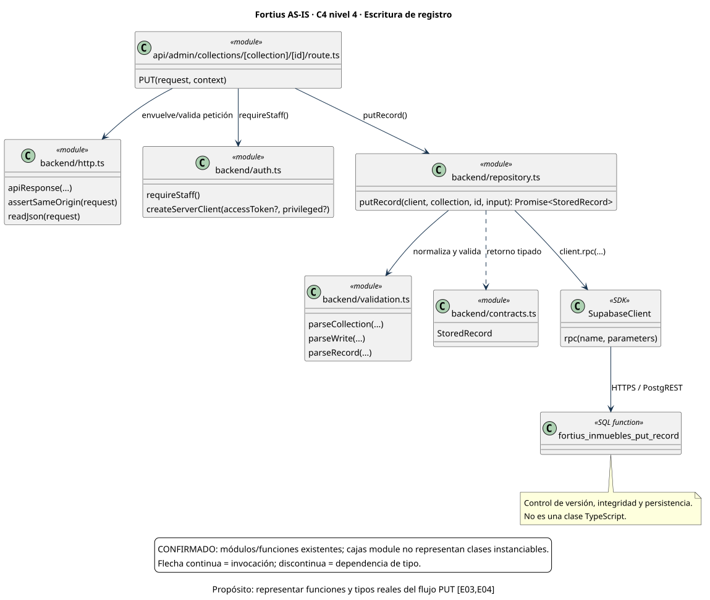

[Fuente PlantUML](as-is/code/record-write.puml) · [Abrir SVG](as-is/code/record-write.svg)

## Fortius AS-IS · C4 nivel 3

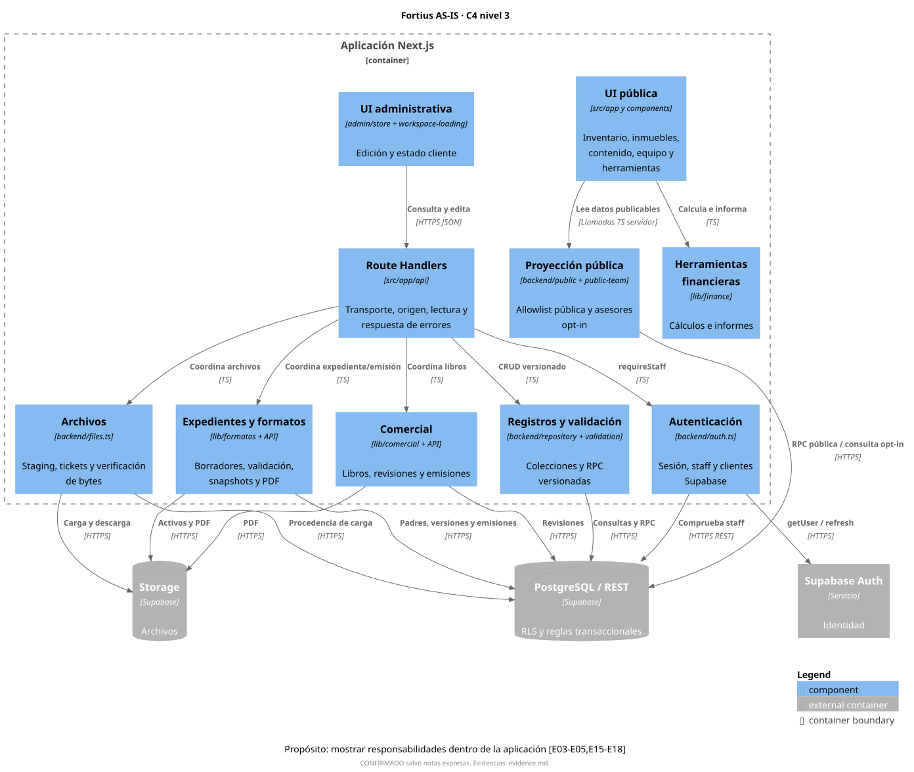

[Fuente PlantUML](as-is/components/application.puml) · [Abrir SVG](as-is/components/application.svg)

## Fortius AS-IS · C4 nivel 2

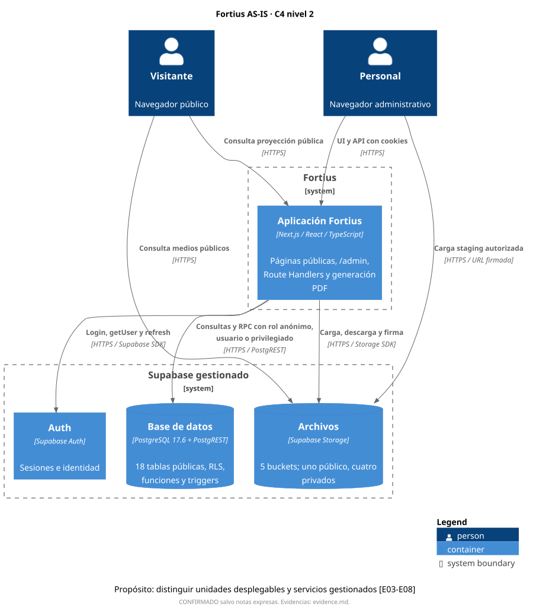

[Fuente PlantUML](as-is/containers.puml) · [Abrir SVG](as-is/containers.svg)

## Fortius AS-IS · C4 nivel 1

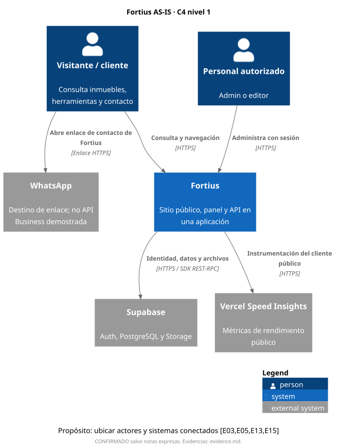

[Fuente PlantUML](as-is/context.puml) · [Abrir SVG](as-is/context.svg)

## Fortius AS-IS · Modelo de datos

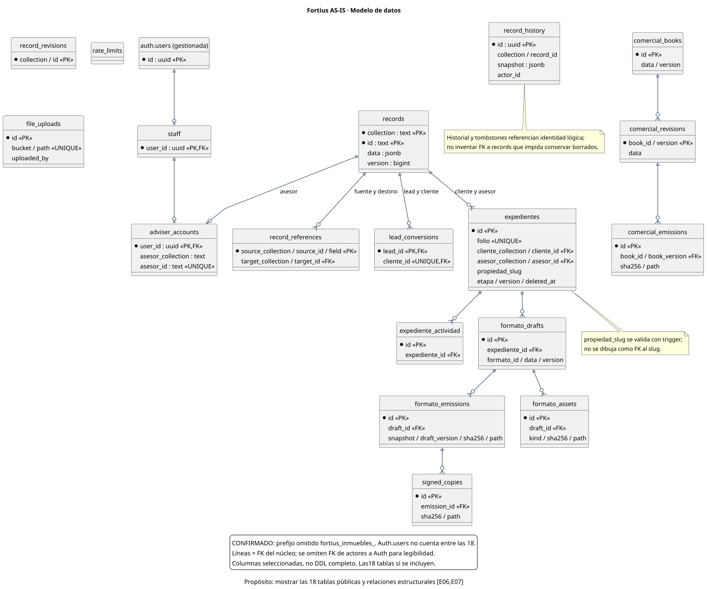

[Fuente PlantUML](as-is/data-model.puml) · [Abrir SVG](as-is/data-model.svg)

## Fortius AS-IS · Despliegue observado

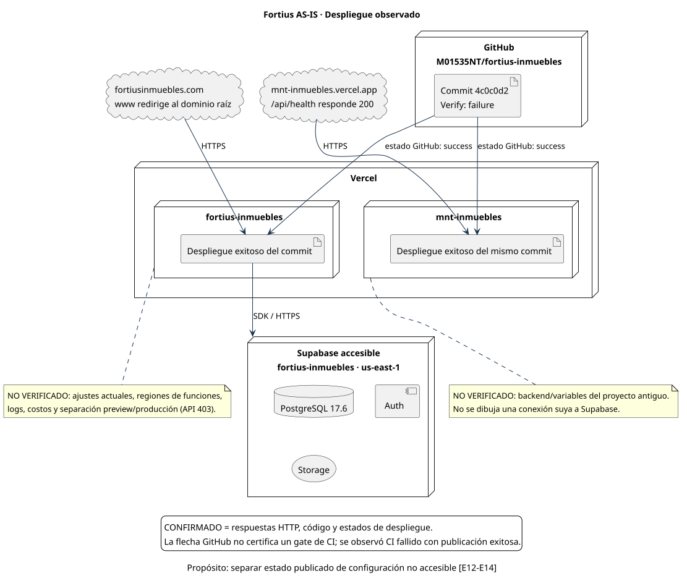

[Fuente PlantUML](as-is/deployment.puml) · [Abrir SVG](as-is/deployment.svg)

## Fortius AS-IS · Autenticación de una solicitud

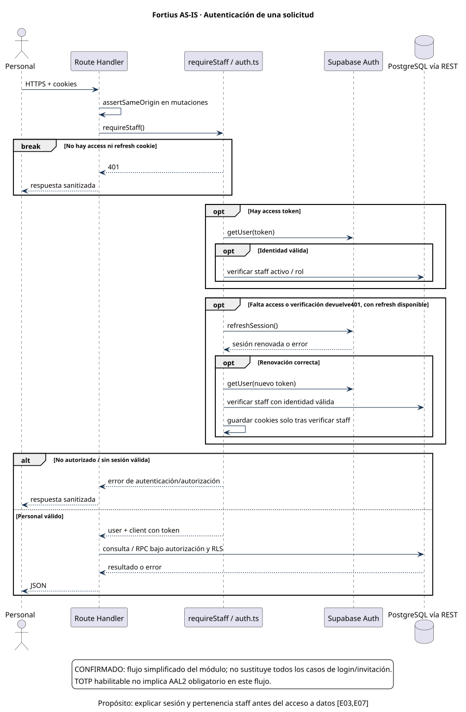

[Fuente PlantUML](as-is/sequences/authentication.puml) · [Abrir SVG](as-is/sequences/authentication.svg)

## Fortius AS-IS · Emisión de PDF

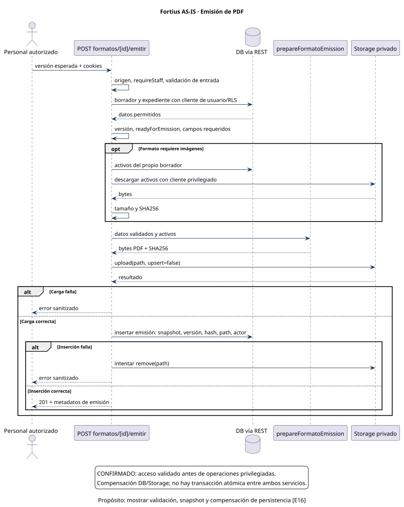

[Fuente PlantUML](as-is/sequences/document-emission.puml) · [Abrir SVG](as-is/sequences/document-emission.svg)

## Fortius TO-BE · C4 nivel 3

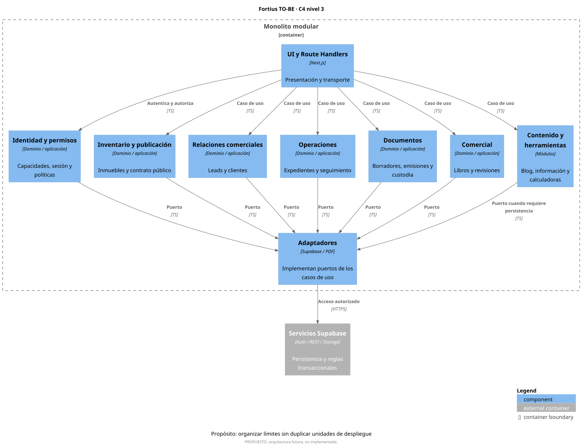

[Fuente PlantUML](to-be/components/domains.puml) · [Abrir SVG](to-be/components/domains.svg)

## Fortius TO-BE · C4 nivel 2

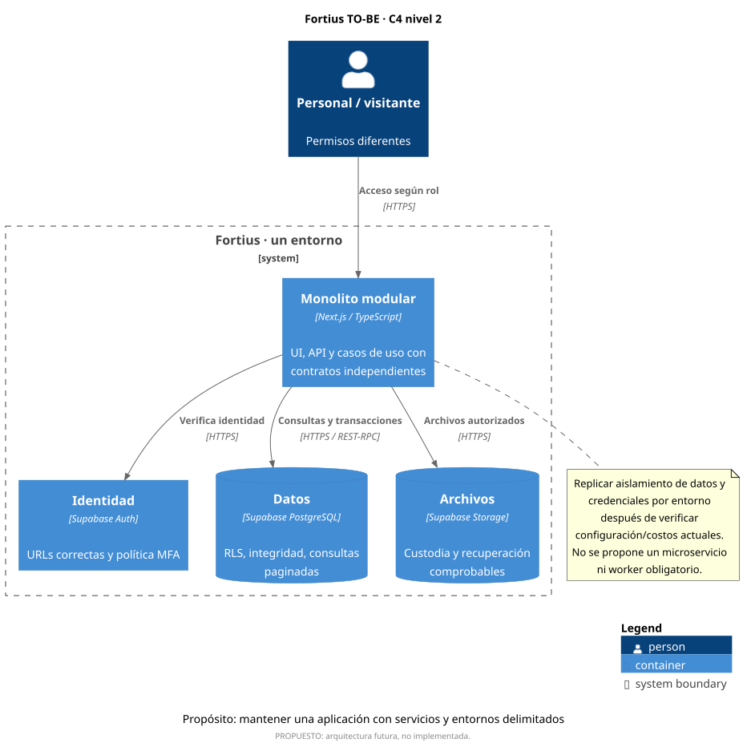

[Fuente PlantUML](to-be/containers.puml) · [Abrir SVG](to-be/containers.svg)

## Fortius TO-BE · C4 nivel 1

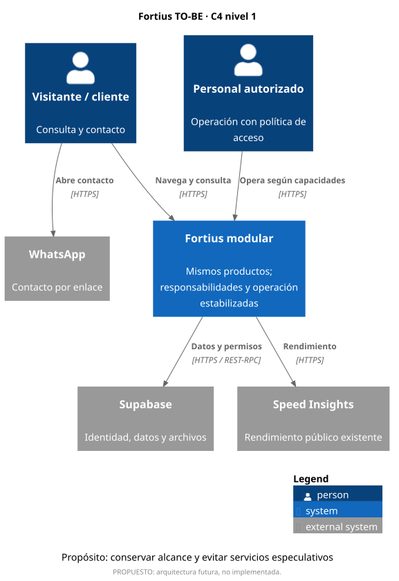

[Fuente PlantUML](to-be/context.puml) · [Abrir SVG](to-be/context.svg)

---

# Renderizado y reproducibilidad

## Qué ocurrió

En la fase de auditoría anterior **no se ejecutó el renderizado**: no había ejecutable/JAR de PlantUML disponible y el encargo prohibía instalar dependencias. Por tanto, entonces no había evidencia de un fallo de sintaxis ni de que los diagramas fueran irrenderizables.

La autorización posterior incluyó renderizado y archivos documentales. Se utilizó un JAR temporal aislado en `/tmp/fortius-architecture-render`, sin añadir paquetes al proyecto, cambiar lockfiles ni configurar infraestructura. Java y Graphviz ya estaban disponibles. C4-PlantUML está incluido en la biblioteca estándar del JAR; no se requirió un servidor público de renderizado ni se envió la arquitectura a terceros.

Durante esta ejecución aparecieron dos errores de sintaxis en los diagramas complementarios: saltos de línea literales dentro de etiquetas entre comillas en despliegue y declaraciones entity de una sola línea en el modelo de datos. Se corrigieron usando escapes de línea y bloques multilínea. Los diagramas C4 no presentaron esos errores. La revisión visual detectó además que la biblioteca C4 ocultaba la leyenda personalizada; se activó su visualización explícitamente.

## Motor fijado

- PlantUML **1.2026.8**, build149874a; biblioteca C4 incluida en ese artefacto.
- JAR oficial: https://github.com/plantuml/plantuml/releases/download/v1.2026.8/plantuml.jar
- SHA-256 verificado contra digest de GitHub: `5e1ecfa8ecd32c90b03bbf3b1eb6f020943f98ab0fcf4032be31a0002ee2c462`.
- Java OpenJDK disponible en el entorno; Graphviz2.42.4.
- Los includes `<C4/C4_Context>`, `<C4/C4_Container>` y `<C4/C4_Component>` se resuelven dentro del JAR.

## Resultado

Once fuentes `.puml`, once SVG y once PNG. El renderizado final de ambas salidas terminó con código0. SVG es el formato recomendado para ampliar los diagramas sin pérdida. Se revisaron imágenes, títulos, etiquetas y leyendas. Esto comprueba sintaxis y composición; no convierte inferencias en hechos ni sustituye la evidencia del informe.

Comandos reproducibles, ejecutados desde la raíz del repositorio con el JAR ya disponible:

```bash
java -Djava.awt.headless=true -jar /tmp/fortius-architecture-render/plantuml.jar -tsvg -failfast2 'docs/architecture/**/*.puml'
java -Djava.awt.headless=true -jar /tmp/fortius-architecture-render/plantuml.jar -tpng -failfast2 'docs/architecture/**/*.puml'
```

El JAR temporal no se incluye en la entrega ni se considera dependencia de Fortius. Para reproducir en otra máquina, verificar su digest y disponer de Java/Graphviz. No se requiere desplegar la aplicación.
---

# Inventario de rutas y migraciones

CONFIRMADO: archivos presentes en el commit auditado. Una ruta identificada no implica que cada comportamiento se haya probado. Los grupos de App Router se conservan como rutas de archivo para evitar inferir URLs incorrectas.

## Páginas

- `src/app/admin/archivos/page.tsx`
- `src/app/admin/asesores/page.tsx`
- `src/app/admin/blog/page.tsx`
- `src/app/admin/calendario/page.tsx`
- `src/app/admin/clientes/[id]/page.tsx`
- `src/app/admin/clientes/page.tsx`
- `src/app/admin/configuracion/page.tsx`
- `src/app/admin/contenido/page.tsx`
- `src/app/admin/control-comercial/page.tsx`
- `src/app/admin/expedientes/page.tsx`
- `src/app/admin/historial/page.tsx`
- `src/app/admin/leads/[id]/page.tsx`
- `src/app/admin/leads/page.tsx`
- `src/app/admin/notas/page.tsx`
- `src/app/admin/page.tsx`
- `src/app/admin/perfil/page.tsx`
- `src/app/admin/propiedades/[slug]/editar/page.tsx`
- `src/app/admin/propiedades/nueva/page.tsx`
- `src/app/admin/propiedades/page.tsx`
- `src/app/admin/reportes/page.tsx`
- `src/app/admin/tareas/[id]/page.tsx`
- `src/app/admin/tareas/page.tsx`
- `src/app/avisos/page.tsx`
- `src/app/blog/[slug]/page.tsx`
- `src/app/blog/page.tsx`
- `src/app/comercial/page.tsx`
- `src/app/comprar-propiedad/page.tsx`
- `src/app/contacto/page.tsx`
- `src/app/due-diligence-inmobiliaria/page.tsx`
- `src/app/herramientas/gastos-de-cierre/page.tsx`
- `src/app/herramientas/hipoteca/page.tsx`
- `src/app/herramientas/page.tsx`
- `src/app/industrial/page.tsx`
- `src/app/inventario/[slug]/page.tsx`
- `src/app/inventario/page.tsx`
- `src/app/nosotros/page.tsx`
- `src/app/page.tsx`
- `src/app/privacidad/page.tsx`
- `src/app/residencial/page.tsx`
- `src/app/terminos/page.tsx`
- `src/app/vender-propiedad/gracias/page.tsx`
- `src/app/vender-propiedad/page.tsx`
- `src/app/zonas/[zona]/page.tsx`
- `src/app/zonas/page.tsx`

## Route Handlers

- `src/app/api/admin/adjuntos/[id]/descargar/route.ts`
- `src/app/api/admin/asesor-cuentas/route.ts`
- `src/app/api/admin/collections/[collection]/[id]/route.ts`
- `src/app/api/admin/collections/[collection]/route.ts`
- `src/app/api/admin/comercial/[id]/emitir/route.ts`
- `src/app/api/admin/comercial/[id]/route.ts`
- `src/app/api/admin/comercial/emisiones/[id]/route.ts`
- `src/app/api/admin/comercial/route.ts`
- `src/app/api/admin/copias-firmadas/[id]/descargar/route.ts`
- `src/app/api/admin/emisiones/[id]/descargar/route.ts`
- `src/app/api/admin/emisiones/[id]/firmado/route.ts`
- `src/app/api/admin/expedientes/[id]/actividad/route.ts`
- `src/app/api/admin/expedientes/[id]/formatos/route.ts`
- `src/app/api/admin/expedientes/[id]/operacion/route.ts`
- `src/app/api/admin/expedientes/[id]/route.ts`
- `src/app/api/admin/expedientes/route.ts`
- `src/app/api/admin/files/complete/route.ts`
- `src/app/api/admin/files/route.ts`
- `src/app/api/admin/files/upload/route.ts`
- `src/app/api/admin/formatos/[id]/adjuntos/route.ts`
- `src/app/api/admin/formatos/[id]/emitir/route.ts`
- `src/app/api/admin/formatos/[id]/route.ts`
- `src/app/api/admin/historial/route.ts`
- `src/app/api/admin/leads/[id]/convertir/route.ts`
- `src/app/api/admin/mi-asesor/route.ts`
- `src/app/api/auth/callback/route.ts`
- `src/app/api/auth/login/route.ts`
- `src/app/api/auth/logout/route.ts`
- `src/app/api/auth/password/route.ts`
- `src/app/api/auth/profile/photo/route.ts`
- `src/app/api/auth/profile/route.ts`
- `src/app/api/auth/recovery/route.ts`
- `src/app/api/auth/session/route.ts`
- `src/app/api/health/route.ts`
- `src/app/api/leads/route.ts`
- `src/app/api/public/leads/route.ts`
- `src/app/avisos/[documento]/route.ts`
- `src/app/inventario/[slug]/ficha-tecnica/route.ts`
- `src/app/inventario/[slug]/imagen-social/route.ts`

## Migraciones versionadas

- `supabase/migrations/202609030001_fortius_inmuebles_backend.sql`
- `supabase/migrations/202609030002_fortius_inmuebles_record_revisions.sql`
- `supabase/migrations/202609060003_fortius_inmuebles_identity.sql`
- `supabase/migrations/202609060004_fortius_inmuebles_content_identity.sql`
- `supabase/migrations/202609060005_retire_public_read_compatibility.sql`
- `supabase/migrations/202609230006_fortius_inmuebles_tasks.sql`
- `supabase/migrations/202609230007_fortius_inmuebles_home_editorial.sql`
- `supabase/migrations/202609240008_fortius_inmuebles_blog_editorial.sql`
- `supabase/migrations/202610040009_fortius_inmuebles_expedientes.sql`
- `supabase/migrations/202610040010_fortius_inmuebles_formato_assets.sql`
- `supabase/migrations/20261005000752_fortius_inmuebles_comercial.sql`
- `supabase/migrations/20261005004358_fortius_inmuebles_private_upload_provenance.sql`
- `supabase/migrations/20261005011326_fortius_inmuebles_expediente_row_scope.sql`
- `supabase/migrations/20261005013631_fortius_inmuebles_lead_conversion.sql`
- `supabase/migrations/20261005035035_fortius_inmuebles_identity.sql`
- `supabase/migrations/20261005040239_fortius_inmuebles_retire_compatibility.sql`
- `supabase/migrations/20261005052643_fortius_inmuebles_expediente_deletion.sql`
- `supabase/migrations/20261005060000_fortius_inmuebles_expediente_operations.sql`
- `supabase/migrations/20261005061000_fortius_inmuebles_calendar_links.sql`
- `supabase/migrations/20261005062000_fortius_inmuebles_property_integrity.sql`
- `supabase/migrations/20261008210000_fortius_admin_history.sql`
