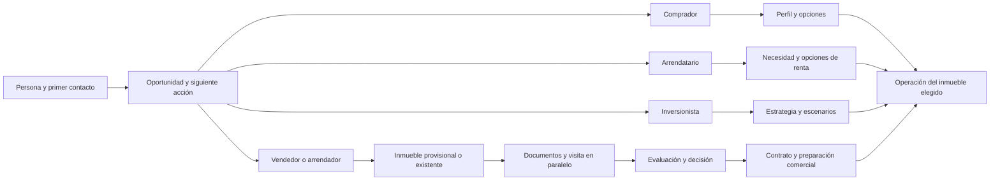

# Fortius Inmuebles: auditoría de procesos y plan de mejora

**Revisión R2 · 14 de octubre de 2026 · Navegación de consulta ampliada; validación operativa parcial**

Destinatarios: dirección de Fortius y responsables de producto, operación y desarrollo. Propósito: ordenar la captación y los recorridos de vendedor, arrendador, comprador, arrendatario e inversionista. Esta revisión no autoriza implementación, eliminación de funciones o modificación de expedientes.

## 1. Diagnóstico ejecutivo

Fortius ya permite iniciar una operación con una persona sin seleccionar un inmueble. La captura guiada distingue cinco intenciones, guarda entrevistas incompletas y, al completarlas, convierte el prospecto en cliente, abre una operación y crea una tarea. La versión más reciente examinada también crea el inmueble privado del propietario desde la entrevista. Por ello, no corresponde proponer ese recorrido como si todo estuviera ausente.

La principal debilidad es la convivencia de varios modelos: persona/prospecto, cliente, entrevista, inmueble, expediente, guía, cartera comercial y herramientas. Sus relaciones conservan parte del contexto, pero no constituyen todavía una captura única ni cinco procesos completos. Las rentas carecen de las compuertas de venta; el inversionista termina dentro del recorrido comprador; los formatos se capturan aparte; y un inmueble admitido a evaluación se registra como disponible.

Los ensayos aislados de la versión reciente reprodujeron fallos concretos: corregir la ubicación puede impedir completar la entrevista; repetir una dirección genera otro inmueble; y una operación de renta puede pasar de documentación a cerrado con una tarea pendiente. La publicación guiada protege solamente ventas de casas y departamentos. Esto es una brecha del control operativo general; no demuestra que haya ocurrido una publicación indebida en producción.

**Prioridad recomendada:** resolver los fallos de guardado y las diferencias de control; separar admisión a evaluación, aceptación comercial y publicación; después unificar identidad y reutilización. Cambiar nombres o reducir enlaces sin esa base tendría un efecto limitado.

Hay controles que conviene conservar: permisos por asesor y administrador, versiones optimistas, reintentos con identificador estable, entrevistas completadas inmutables, correcciones enlazadas, distinción recibido/revisado, vigencia de determinadas revisiones, tareas con responsable y fecha, historial, recuperación y acciones explícitas de publicación. El bloqueo de emisión del formato 09 debe permanecer mientras no se resuelvan sus condiciones documentales y jurídicas.

La consulta posterior cubrió los 26 destinos distintos del menú del perfil, las seis vistas de procedimiento, el catálogo y los formularios iniciales de las veinte aplicaciones, además de fichas, pestañas, desplegables, captura guiada de los cinco perfiles, buscador y menús contextuales. Quedan sin comprobar escrituras reales, editores de formatos sin documentos existentes, interiores de carteras sin registros, resultados de proveedores y otros perfiles. La auditoría no equivale a una aceptación integral del sistema.

## 2. Entorno, método y cobertura

### Entornos examinados

| Entorno | Identidad y alcance comprobado | Límite |
|---|---|---|
| Producción | `https://fortiusinmuebles.com/admin`; sesión de Moisés Núñez. Consulta inicial en Chrome y continuación en navegador integrado de Codex; Mi perfil y menú identifican Administrador. | No se verificó por separado el rol del servidor ni se ensayó una sesión editor. No se guardaron registros de Fortius. |
| Checkout local | `C:\Paginas-web\fortius-inmuebles`, rama `main`, HEAD `815b0bdc5b0f61ef7158739356acd2ae6fe89f1e`; limpio al inicio. | Estaba ocho commits detrás del `main` remoto consultado. |
| Fuente reciente | GitHub `main` en `8640909a69600cae0dc5cb575be34a81c60c3c4b`; comparación y 38 archivos cambiados pertinentes recuperados en una carpeta de evidencia. | La coincidencia de controles y textos con el panel no identifica por sí sola el commit exacto desplegado ni las migraciones aplicadas remotamente. |
| Ensayo aislado | Copia de 629 archivos pertinentes, con las diferencias de esa revisión superpuestas; ningún `.env`; Node 24.16.0, Vitest, jsdom y PGlite en memoria. | No prueba Supabase Auth/Storage reales, integraciones, correos, firmas, publicación real ni experiencia de todos los navegadores. |

El corte de consulta de versión se registra el 14/10/2026. Fuente del `main` examinado: [commit 8640909](https://github.com/M01535NT/fortius-inmuebles/commit/8640909a69600cae0dc5cb575be34a81c60c3c4b). El checkout activo, sus migraciones y sus funciones no se modificaron para auditar.

Chrome interrumpió la automatización por una interfaz de otra extensión. La sesión iniciada por el usuario en el navegador integrado permitió continuar la navegación. Se consultaron los destinos principales y se desplegaron formularios sin guardar; una fila vacía temporal de ofertas se descartó mediante el control local, sin crear trabajo. No se crearon borradores de formatos ni carteras, porque esas acciones escriben registros reales. **No se declara revisión de todas las variantes de pantalla ni de todas las acciones persistentes.**

### Clases de evidencia

- **L:** comportamiento observado en producción y registrado mediante captura/árbol de interfaz.
- **E:** comportamiento reproducido con datos ficticios en el ensayo aislado.
- **C:** código, validación o migración identificados; sin atribuir su ejecución a producción.
- **I:** consecuencia o recomendación inferida de esas evidencias.
- **P:** comprobación o uso pendiente.

En el inventario, **comprobado** significa que se examinó la unidad indicada, no que todas sus acciones de escritura funcionen. **Parcialmente comprobado** identifica navegación o código examinados con acciones relevantes pendientes. **Pendiente** significa que no se recorrió esa pantalla en producción. Las referencias C corresponden al commit remoto indicado cuando el archivo cambió, y al checkout local cuando la comparación confirmó que no cambió.

### Inventario principal

| ID | Sección y ruta | Propósito, acciones y relaciones | Datos y lugar en el proceso | Estado de revisión |
|---|---|---|---|---|
| M01 | Resumen /admin | Nueva operación, indicadores, prioridades, fichas, tareas, agenda, finanzas, zonas y preparación del espacio. | Proyecciones de personas, inmuebles, expedientes y tareas; entrada diaria. | Comprobado L/C en consulta, incluidos desplegables y destinos; 95–97. Sin cambios de preferencias. |
| M02 | Nueva operación /admin/operaciones/nueva | Cinco perfiles; persona nueva/existente; coincidencias de teléfono; iniciar y retomar entrevista. | Intención, nombre, teléfono, correo opcional y responsable; primer contacto. | Parcialmente comprobado L/E/C; contacto de cinco perfiles y selector existente, 108–114. Guardado solo E. |
| M03 | Entrevista /admin/entrevistas/[id] | Propietario: persona/inmueble; otros perfiles: entrevista adaptada. Borrador, completar, consultar y corregir. | Declaraciones, expectativas y próxima acción; admisión a evaluación/búsqueda. | Parcialmente comprobado L/E/C; entrevista histórica completada leída en 23b. Borradores/correcciones de todos los perfiles sin abrir mediante escritura productiva. |
| M04 | CRM /admin/leads | Lista/etapas, filtros, búsqueda, convertidos, Nueva operación, captura manual y clientes. | Prospectos, estado relacional, perfil, origen y responsable; entrada y seguimiento. | Parcialmente comprobado L/C; lista/etapas, filtros, cuatro convertidos y perfil manual sin guardar, 103–107. |
| M05 | Ficha prospecto /admin/leads/[id] | Entrevista, preparar operación, perfil, estados, notas, contacto, agenda y relaciones. | Persona e historial previo a conversión. | Parcialmente comprobado L/C/E; ficha convertida e historial, 22b. Sin cambios de estado/notas/agenda. No había prospecto sin convertir para ensayar esa variante. |
| M06 | Clientes /admin/clientes | Buscar nombre/teléfono/correo, alta, editar y abrir ficha. Eliminación de no convertidos identificada en C. | Identidad, tipo único y perfil; directorio. | Parcialmente comprobado L/C; lista y alta 19/20; editor en ficha 101/102. No existe filtro de tipo en esta lista examinada. |
| M07 | Ficha cliente /admin/clientes/[id] | Abrir operación, editar perfil, historial del lead, tareas/agenda y referencias. | Persona, necesidades e historial de conversión. | Parcialmente comprobado L/C; ficha, tarea vinculada y editor completo 100–102. Ninguna edición guardada. |
| M08 | Operaciones /admin/expedientes | Buscar cliente/folio, grupos, activos/eliminados, alta directa, pestañas, guía, documentos y recuperación. | Encargo, cliente, asesor, inmueble opcional, etapas, documentos y actividad. | Parcialmente comprobado L/E/C; dos vendedores y un comprador; cinco pestañas, alta directa y entrada desde inmueble, 06–12/24–26/41. Documento, emisión y recuperación productivos pendientes. |
| M09 | Inmuebles /admin/propiedades | Tarjetas/lista, filtros/vistas, nuevo, editar, estado, destacar, ver público y eliminar. | Registro maestro y presentación comercial en la misma colección. | Parcialmente comprobado L/C/E; filtros, vistas y menú con responsable/documentos, 33–35. Sin cambiar estado, destacado ni publicación. |
| M10 | Nuevo/editar inmueble /admin/propiedades/nueva; /admin/propiedades/[slug]/editar | Seis secciones, biblioteca, vista previa, copia temporal, guardar y publicar/retirar. | Tipo, operación, ubicación, precio, superficies/fuentes, descripción, asesor, fotos y PDFs públicos. | Parcialmente comprobado L/C/E; secciones, biblioteca, vista previa y edición demo en consulta, 36–40. Carga, copia temporal, guardado y publicación pendientes. |
| M11 | Documentos /admin/documentos | Folio/formato, buscar, abrir documento; biblioteca, notas, inmueble y expediente. | Índice de borradores por operación. | Comprobado L/C el índice vacío y desplegable de herramientas, 42/43. Sin documentos existentes para abrir editor; ese interior sigue pendiente en M08. |
| M12 | Hoy/Tareas /admin/tareas; /admin/tareas/[id] | Alta/plantillas, filtros, ficha, estado, pasos, notas e historial. | Tarea con responsable/fecha y vínculos a persona/inmueble/expediente. | Parcialmente comprobado L/C/E; dos tareas, ficha, alta, filtros/vínculos desplegados, 27–29b. Guardar, completar y cancelar no ejecutados. |
| M13 | Agenda /admin/calendario | Mes, semana, próximos, día, formulario, editar/eliminar y vínculos. | Evento con fecha/hora, tipo, personas, asesor e inmueble/expediente. Muestra vencimientos aparte. | Parcialmente comprobado L/C; tres vistas y formulario, 30–32. Sin eventos existentes para editar; agendar/eliminar no ejecutados. |
| M14 | Notas /admin/notas | Alta con título/contenido, edición directa y eliminar. | Texto interno; no sustituye evidencia o actividad del expediente. | Parcialmente comprobado L/C, 44. No se editó la nota existente. Fijar/filtrar no se identificaron en esta pantalla. |
| M15 | Archivos /admin/archivos | Carga, visibilidad, enlace existente, filtros por tipo, abrir y quitar de biblioteca. | Recursos públicos/privados; carga privada por defecto, límite indicado 20 MB. | Parcialmente comprobado L/C; biblioteca y registro de enlace desplegado, 45/46. Sin carga, apertura externa ni eliminación. |
| M16 | Control comercial /admin/control-comercial | Seleccionar/crear cartera. Oportunidades, gestión, configuración, historia, revisión y PDF 03 identificados en C. | Priorización/compromisos de cartera; referencia opcional al expediente. | Parcialmente comprobado L/C; selector cargado sin carteras, 47b. Interiores pendientes por requerir creación persistente. |
| M17 | Reportes /admin/reportes | Situación actual, periodo/asesor, primera atención, convertidos, cartera, asignación y etapas. | Métricas del CRM/control comercial con denominadores y alcances distintos. | Parcialmente comprobado L/C, 48; cifras, alcances y accesos vistos. Detalles de carteras sin datos y exportación pendientes. |
| M18 | Finanzas /admin/finanzas | Neto/presupuesto, cartera, hipoteca, gastos de cierre, inversiones y comisiones. | Accesos a escenarios; sin libro de cobros/egresos reales. | Comprobado L/C el acceso y alcance, 49. Formularios de motores en M27; cálculos con datos reales no ensayados. |
| M19 | Territorio /admin/territorio | Agrupación por zona, alcance demo y abrir inventario/inmueble. | Proyección de zonas; mapa de este módulo pendiente. | Comprobado L/C en alcance vacío y agrupación con tres demos, 50/51. Sin calcular ruta ni comparable. |
| M20 | Portal /admin/portal-clientes | Pantalla prevista: operación, documentos, agenda y mensajes. | No habilita acceso externo ni recepción documental. | Comprobado L/C el carácter pendiente de implementación, 52. No existe flujo funcional del cliente que probar aquí. |
| M21 | Asesores /admin/asesores | Alta/edición, activo, ficha pública y cuentas editor según permisos. | Responsable operativo y cuenta de acceso son distintos. | Parcialmente comprobado L/C; lista/formulario completo, 53/54. Sin crear cuentas ni cambiar permisos/fichas públicas. |
| M22 | Blog /admin/blog | Lista, alta/edición, tipo/tema, destacado, estado público, fuente y eliminación. | Artículos públicos; fuera de la captación individual. | Parcialmente comprobado L/C, 55/62; formulario sin guardar. Publicar/eliminar no ejecutados. |
| M23 | Contenido /admin/contenido | Hero, Por qué Fortius, SEO, método, entregables, FAQ y contacto. | Textos/metadatos del sitio. | Parcialmente comprobado L/C; cinco desplegables y campos, 56/57. Guardado no ejecutado. |
| M24 | Configuración /admin/configuracion | Identidad, teléfono/WhatsApp/correo/horario, redes y video. | Datos del negocio y sitio. | Parcialmente comprobado L/C, 58; sin guardar. Repetición contextual del enlace en menú/pie/usuario revisada. |
| M25 | Historial /admin/historial | Actividad/eliminados, módulo, paginación y restaurar entidades admitidas. | Autor/versiones y recuperación; expedientes desde su módulo. | Parcialmente comprobado L/C; actividad y eliminados vacíos, 59/61. Ninguna restauración ejecutada. |
| M26 | Perfil /admin/perfil | Nombre/foto, densidad local y contraseña. | Identidad de sesión; distinta de ficha pública del asesor. | Parcialmente comprobado L/C, 60; Administrador visible. Sin cambiar nombre/foto, preferencias ni seguridad. |
| M27 | Aplicaciones /admin/apps; /admin/apps/[slug] | Catálogo/lanzador, nuevo/guardado, contexto, versiones, resultados/exportación/proveedores. | Veinte herramientas descritas individualmente en el anexo. | Parcialmente comprobado L/C; veinte formularios iniciales, 64b–84, selector común de trabajos vacío, 65. Filas/resultados condicionales, versiones existentes, cargas/proveedores con pendientes. |

Se identificaron **31 archivos de página** administrativos. Es un conteo de plantillas de ruta, no 31 pantallas recorridas: `/proceso/[stage]` resuelve seis vistas y `/apps/[slug]` veinte herramientas. Las fichas por ID y los estados de formularios añaden unidades que no se reducen a ese conteo.

### Vistas de procedimiento y acciones ocultas o contextuales

| Unidad | Rutas/acciones y relación | Cobertura |
|---|---|---|
| Procedimiento | `/admin/proceso/captacion` → etapa `captacion`; `/preparacion` → `documentacion`; `/promocion` → `comercializacion`; `/negociacion` → `negociacion`; `/cierre` → `cierre`; `/postventa` agrupa `entrega`, `postventa` y `cerrado`. Proyecciones del mismo expediente. | Comprobado L/C: seis interiores y vínculos, 89–94. Cuatro vistas vacías no prueban el recorrido de registros avanzados. |
| Alta directa | Desde Operaciones o inmueble; cliente, tipo de operación, inmueble opcional, ruta/unidad; asesor ligado al cliente y folio automático. | Formulario y propiedad preseleccionada desde enlace comprobados L en 26/41; guardado/uso real pendiente, E/C de reglas. |
| Pestañas expediente | Siguiente paso, Documentos, Tareas, Actividad y Vista avanzada. La última muestra juntos los mismos componentes; no crea otros registros. | Las cinco abiertas L; guardado pendiente. |
| Guías vendedor/comprador | Seguimiento, inmueble existente, ruta/situación, contraparte, próxima tarea, requisitos y retroceso. Guardar guía y avanzar son acciones distintas. | Guías revisadas en consulta L 24/25, incluyendo opciones; sin cambiar vínculos ni etapa. E/C de guardado/bloqueos. |
| Formatos | 01; 02; 04A–04G; 05–19. 03 tiene módulo global propio. El selector de expediente contiene 24 opciones; 09 permite preparar captura y mantiene emisión bloqueada. | Selector observado L; editores por formato, PDF, adjuntos y copias firmadas pendientes en producción; C del catálogo/servicios. |
| Buscador superior | Personas, inmuebles, tareas y folios; cinco acciones rápidas de entrada. | Comprobado L/C diálogo, destinos y resultados para `EXP-`, 85/86. Resultados de otras entidades pendientes de ensayo específico. |
| Lanzador de aplicaciones | Categorías, búsqueda, veinte destinos y catálogo. | Comprobado L/C diálogo y catálogo, 63/87; veinte páginas iniciales recorridas. Sin cambiar favoritas. |
| Menú de usuario/organización | Perfil, fotografía, contraseña, configuración y salir; orden local de menú y tema. | Controles y modo de organización revisados L 88/98/99; sin reordenar, restablecer, cambiar tema/contraseña ni salir. Menú de escritorio examinado inicialmente en Chrome; no todos los tamaños ensayados. |
| Enlaces relacionados | Persona ↔ operación ↔ inmueble ↔ tarea/agenda; cliente conserva historial del lead. Documentos enlaza borrador por expediente/documento. | Comprobados L los vínculos de cliente/lead/entrevista/expediente/tarea y vencimientos en agenda. Editor documental sin registro existente pendiente. |
| Acciones con efecto externo | Llamar/WhatsApp, enviar firmas, OCR, consulta documental, rutas, enlaces compartidos, publicar, correo de cuenta. | No ejecutadas; C identifica capacidades, P su configuración/resultado real. |

**Catálogo de herramientas comprobado en consulta y contrastado con código:** `ficha-comercial`, `hipoteca`, `comparables`, `ofertas`, `neto-propietario`, `comisiones`, `informe-propietario`, `pdf`, `firmas`, `revisor-expediente`, `fotografias`, `qr`, `rutas`, `conversor`, `inversiones`, `rehabilitacion`, `ocr`, `versiones`, `consulta-documental`, `cotizador`. Todas usan `/admin/apps/<slug>`. Admiten contexto de expediente y trabajos/versiones; esto no acredita integración automática con los formatos. El catálogo señaló servicio pendiente de configuración para Firmas, Rutas, OCR y Consulta documental. No se comprobó su funcionamiento remoto ni se activaron proveedores. El anexo A detalla datos, acciones y límites por herramienta.

## 3. Reconstrucción del proceso actual

### Captura guiada

1. Desde Resumen, CRM o lista de operaciones, **Nueva operación** pide una intención. Existen vendedor, arrendador, comprador, arrendatario e inversionista. El título no significa que ya exista una transacción formalizada.
2. Persona nueva exige nombre, teléfono y asesor activo; correo opcional. No exige inmueble, precio, medidas, fotos ni título. Contacto existente reutiliza un lead o cliente visible. Hay control de teléfono coincidente y excepción explícita para personas que comparten número.
3. Iniciar guarda lead e entrevista borrador. El origen se fija a `manual`. El borrador se puede guardar/releer sin convertir la persona ni crear expediente. En esta vía la siguiente tarea no existe hasta completar la entrevista.
4. La entrevista del propietario separa Persona e Inmueble. Hay 14 preguntas base obligatorias, con respuestas como Por aclarar/Por definir; conocer un importe, declarar alertas o matrimonio activa datos adicionales. Estado civil casado exige cónyuge, incluso si quien responde se declara representante. La ubicación aproximada no es obligatoria. El sistema no pide medidas ni fotos en este momento.
5. Al completar, una transacción conserva el snapshot, convierte el lead si procede, abre expediente, crea tarea y avanza a `documentacion`. Para propietario nuevo, la revisión reciente crea y vincula un inmueble privado con datos declarados. Se guarda `publicada=false`, pero también `estado=disponible` y una fecha `publicadaEl`. Los expedientes históricos observados aún estaban sin inmueble; no se demostró regularización automática de esos antecedentes.
6. Venta usa una guía con dos rutas: captación y compra. Para entrar a documentación desde propietario basta entrevista; para compra, perfil y privacidad. Para comercialización propietaria requiere titularidad, factibilidad vigente, valor, precio, intermediación, levantamiento/material, plan y publicación autorizada. Para negociar exige comprador; cierre/entrega/postventa/archivo añaden otras revisiones y condiciones.
7. Renta utiliza expediente y checklist anteriores, sin guía. Sus etapas no tienen las mismas restricciones de venta. Inversión tiene preguntas propias, pero su operación posterior es venta/ruta compra.
8. Los documentos se preparan en borradores de formatos. Hay adjuntos privados, emisiones y copias firmadas. **No se identificó un circuito completo implementado de solicitud, recepción del cliente, revisión y subsanación por requerimiento.** Las declaraciones de la entrevista, checklist, soportes textuales y archivos son registros diferentes; recibir un archivo no completa automáticamente una revisión.
9. Los requisitos se marcan manualmente con estado y soporte textual; algunas revisiones exigen vigencia. La entrevista tiene un vínculo de soporte validado contra su snapshot actual. En otros requisitos no se exige una referencia estructurada al archivo ni una credencial especializada del revisor. La guía advierte que no emite dictámenes.
10. Existen pausa, regularización y descarte con motivo; retroceso con motivo; borradores y correcciones enlazadas. La guía no distingue una decisión formal de admisión: aceptación, aceptación condicionada, referencia, rechazo y cancelación. El formato 05 sí registra conclusiones de factibilidad y el 17 admite operación cancelada/sustituida y término con seguimiento; son capturas documentales separadas que no sustituyen esa decisión de la guía. Pausar/descartar no cancela automáticamente todas las tareas anteriores. Puede ser correcto para obligaciones supervivientes, pero falta distinguirlas del trabajo comercial suspendido.

### Reutilización actual

Se reutilizan referencias de persona, asesor, operación y, cuando existe, inmueble; la conversión preserva identidad/historial; la tarea de entrevista conserva su vínculo; el contacto existente conserva su ficha. La información de la entrevista no se proyecta de forma general al perfil CRM ni a los formatos 02/12/04/05/07/09. Al crear un formato, la captura inicial es vacía salvo ciertos datos del 01 y las erogaciones base del 08. El precio declarado se traslada al inmueble en el alta reciente, sin constituir precio comercial autorizado. Una corrección posterior de precio no actualiza ni abre una conciliación estructurada con ese dato maestro. El formato 10 sí contiene valor de referencia, precio autorizado, soporte, justificación de diferencia y siguiente decisión; el 08 distingue valor sugerido y precio acordado. Su existencia se comprobó en C; no se demostró transferencia automática ni se llenaron esos formatos en producción.

### ¿Son etiquetas o evidencias?

Las etapas de **venta** tienen efectos reales en validaciones y triggers: no son solo etiquetas. No obstante, el contenido de varias revisiones sigue acreditado por texto manual, y una observación de cualquier requisito puede bloquear todo avance. Las vistas del menú son etiquetas/proyecciones de esas etapas. En **renta**, el ensayo demostró que la etiqueta se puede cambiar saltando etapas; allí falta el proceso equivalente. La fase actual “Revisión y preparación” agrupa evaluación, decisión, contratación y preparación comercial, lo que oculta decisiones distintas.

## 4. Registro priorizado de hallazgos

P0: fallos que deben resolverse antes de confiar en el recorrido afectado. P1: alta repercusión operativa o de datos. P2: simplificación o coherencia con menor urgencia. La frecuencia poblacional no se midió; las condiciones de repetición siguientes son estimaciones basadas en reglas y ensayos, no tasas de usuarios.

### H01 · Corregir ubicación puede bloquear el guardado final — P0

**Sección/acción:** entrevista `/admin/entrevistas/[id]`, completar corrección del propietario. **Actual/reproducción:** completar una entrevista; abrir corrección sobre su expediente; cambiar ubicación y completar. AUD-T10 devuelve `PT409: El soporte debe corresponder a la entrevista actual`; la transacción revierte y la corrección queda borrador. **Evidencia:** E, migración `20261014180000_capture_property_from_operational_interviews.sql`, función `save_intake`, y trigger `fortius_02_interview_evidence` de `20261014054506_operational_interviews.sql`.

**Problema/consecuencia:** el snapshot nuevo se guarda antes de actualizar unidad/vínculo, pero esa actualización intermedia conserva el soporte anterior; el trigger lo compara con la entrevista nueva. Error funcional, severidad alta; reproducido en un caso aislado, esperable al repetir esa condición. **Propuesta:** hacer consistente la actualización de snapshot, contexto y referencia de revisión dentro de la transacción, e invalidar únicamente revisiones afectadas. **Dependencias/riesgos:** triggers, versiones, rollback, tareas y publicación; no desactivar el control de soporte. **Aceptación:** corrección de domicilio/importe/contacto se guarda o abre conflicto explícito, conserva versión previa y no produce evidencia ni publicación indebidas. **Certeza:** comprobado E/C; repetición en producción pendiente.

### H02 · Arrendatario y arrendador no tienen proceso controlado equivalente — P0

**Sección/acción:** expediente de renta, cambiar etapa. **Actual/reproducción:** completar entrevista `rentar`; queda `flujo=null`; invocar actualización de etapa `cerrado` desde documentación. AUD-T05 lo permite con tarea pendiente. **Evidencia:** E; `ExpedienteOperationPanel` solo activa guía para `operacion=venta`; trigger `guard_guided_operation` limita compuertas de avance a venta.

**Problema/consecuencia:** cierre registrado sin evidencia de selección, contrato, pagos, entrega o pendientes. Error de proceso/estructura, severidad alta; condición sistemática de renta, frecuencia de uso desconocida. **Propuesta:** dos procesos de renta, uno del arrendador y otro del arrendatario, con requisitos proporcionales y dependencias propias. **Dependencias/riesgos:** modelo de guías, contratos de renta, referencias, permisos e históricos; no copiar compraventa/escritura a una renta. **Aceptación:** no archivar con obligaciones pendientes; separar acuerdo, formalización, pago, entrega y archivo; permitir trabajos en paralelo. **Certeza:** comprobado E/C; UI/guardado real de renta pendiente.

### H03 · El control de autorización para publicar es parcial por tipología — P0

**Sección/acción:** publicar inmueble, API `/api/admin/propiedades/[slug]/publicacion`. **Actual/reproducción:** para operación distinta de venta o tipo distinto de casa/departamento, la API devuelve permiso sin exigir la guía; el trigger aplica la misma selección. AUD-T13 permite publicar un terreno con guía de captación incompleta y sin revisión de intermediación. **Evidencia:** E/C, ruta de publicación y `guard_guided_publication`.

**Problema/consecuencia:** el control de autorización del encargo cambia según tipo, sin un piso operativo común. Error de proceso, severidad alta; se activa en publicaciones de terreno/comercial/industrial/renta, frecuencia real desconocida. **Propuesta:** autorización, precio/material aprobado y bloqueos críticos para toda publicación; requisitos jurídicos específicos condicionados a la operación. **Dependencias/riesgos:** tipología, proyección pública y anuncios históricos; no aplicar NOM-247 universalmente ni retirar anuncios históricos en lote. **Aceptación:** cada tipología permite publicar con evidencia aplicable y rechaza falta de autorización; matriz de no aplicación motivada; revisión individual de legacy. **Certeza:** comprobado E/C, sin publicación real durante auditoría.

### H04 · Un inmueble provisional figura como disponible — P1

**Sección/acción:** completar entrevista; resumen e inventario. **Actual/reproducción:** AUD-T02 crea inmueble privado, `estado=disponible`, `publicadaEl` con fecha; el Resumen cuenta disponibles por estado y exclusión demo, sin comprobar aceptación comercial. **Evidencia:** E/C, migración reciente y `/admin/page.tsx`.

**Problema/consecuencia:** la admisión a evaluación puede inflar disponibilidad comercial; fecha de publicación no significa publicación. Datos/error de proceso, severidad alta; aplicable a cada alta propietaria de esta vía. **Propuesta:** estado de captación provisional independiente de disponibilidad y publicación; asignar fecha pública cuando ocurra el evento. **Dependencias/riesgos:** filtros, reportes, métricas, terceros y registros antiguos. **Aceptación:** caso provisional visible al asesor, excluido de inventario comercial/indicador de disponibles; publicar solo mediante autorización. **Certeza:** comprobado E/C; efecto cuantitativo en producción no medido.

### H05 · La presentación repetida del mismo inmueble genera otra identidad — P1

**Sección/acción:** Nueva operación y completar entrevista sobre contacto existente. **Actual/reproducción:** misma persona, tipo y dirección; la segunda entrevista crea otro `cap<uuid>` y otro expediente. AUD-T04 confirma dos inmuebles con idéntica dirección. Vincular uno existente desde la guía posterior no evita el alta previa. **Evidencia:** E/C, `property_id` generado por entrevista sin búsqueda de coincidencias.

**Problema/consecuencia:** documentos, tareas, disponibilidad y decisiones se dispersan. Datos/duplicidad, severidad alta; esperable en recontactos, frecuencia desconocida. **Propuesta:** búsqueda asistida de identidad al crear el provisional, con domicilio/unidad y, cuando existan, clave/folio; confirmar nueva unidad o vincular existente. **Dependencias/riesgos:** normalización, permisos y unidades jurídicas; una dirección igual no prueba identidad, ni autoriza fusionar operaciones históricas. **Aceptación:** repetir inmueble conserva identidad técnica y permite otro encargo legítimo; otro inmueble de la misma persona sí crea identidad nueva. **Certeza:** comprobado E/C; duplicados productivos no inventariados.

### H06 · Entrevista, perfil, inmueble y formatos requieren conciliación/captura repetida — P1

**Sección/acción:** entrevista, CRM y creación de formatos en `/admin/expedientes`. **Actual/reproducción:** completar entrevista; preparar 02/12/04/05/09; `createDocumento` inicia sus datos en `{}`. No existe mapeo general de los nombres de campo. AUD-T15 guarda importe corregido 7 millones mientras el inmueble conserva 8 millones. La entrevista histórica consultada contiene tipo y expectativa que el editor de perfil vuelve a mostrar sin completar. **Evidencia:** L 23b/102 sobre ese antecedente; E/C, `createDocumento`, catálogos y `save_intake`. El formato 10 ya permite registrar la diferencia valor/precio; el hallazgo se refiere a transferencia/conciliación, no a ausencia total de esa función.

**Problema/consecuencia:** recaptura de nombres, ubicación, expectativas y responsable, más posibles versiones contradictorias. Datos/duplicidad, severidad alta; frecuente en preparación documental, tasa no medida. **Propuesta:** prellenado con fuente/versión y estados declarado/verificado; cambios propuestos al maestro, con confirmación de conflictos; documentos emitidos congelados. **Dependencias/riesgos:** esquemas 02/12/04/05/07/08/09, nombres de campo y privacidad. No sobrescribir evidencias verificadas ni PDFs firmados. **Aceptación:** dato existente se reutiliza; solo se pide lo nuevo; correcciones no dejan divergencia silenciosa; 07 → 08 transfiere referencia y valor con aceptación explícita. **Certeza:** comprobado L para el antecedente consultado, E/C para inicialización/conciliación; recaptura manual real no cronometrada.

### H07 · El rol de la persona determina la agrupación de operaciones — P1

**Sección/acción:** clientes/operaciones, grupos de la lista. **Actual/reproducción:** propietario existente inicia compra; AUD-T11 conserva `clientes.tipo=propietario` y crea ruta compra. La lista agrupa por tipo del cliente, no por intención de la operación. **Evidencia:** E/C, `ExpedienteClientList` y conversión/intake.

**Problema/consecuencia:** una compra puede aparecer bajo Vendedores; una persona no puede representarse bien como vendedor, comprador e inversionista a la vez. Datos/arquitectura, severidad alta; cada cambio o coexistencia de rol, volumen desconocido. **Propuesta:** persona maestra con roles por oportunidad/operación, conservar tipo histórico sin usarlo como único criterio operativo. **Dependencias/riesgos:** agrupación, filtros, preselección, conversión, permisos y reportes. **Aceptación:** misma persona con venta, compra y renta aparece en sus recorridos correctos, sin duplicar identidad ni alterar el expediente anterior. **Certeza:** comprobado E/C; ejemplo multirrol en UI productiva pendiente.

### H08 · El primer contacto no registra origen específico ni siguiente acción en la vía guiada — P1

**Sección/acción:** contacto de `/admin/operaciones/nueva`. **Actual/reproducción:** nombre, teléfono, correo y asesor son los campos observados en los cinco perfiles; la función fija origen manual. AUD-T01 guarda borrador sin tarea; próxima acción/fecha se solicitan para completar entrevista. **Evidencia:** L 04/109–114; E/C, `start_intake`/`save_intake`. La vía manual del CRM sí permite registrar próximo contacto antes, pero no ofrece ese dato en el contacto guiado.

**Problema/consecuencia:** una llamada interrumpida deja contacto/entrevista sin compromiso operativo explícito; el canal comercial se pierde. Error de proceso/mejora, severidad media-alta; probable en llamadas breves, frecuencia desconocida. **Propuesta:** primer contacto independiente con intención, origen, responsable por defecto y próxima acción; continuar entrevista opcionalmente. Admitir medio de contacto adecuado, sin imponer teléfono cuando solo hay correo. **Dependencias/riesgos:** validación de persona, tareas, privacidad y deduplicación; no crear tarea duplicada al completar entrevista. **Aceptación:** contacto mínimo queda guardado y retomable con responsable y acción/fecha o evento; la segunda fase reutiliza todo. **Certeza:** comprobado L/E/C sobre campos y tarea; frecuencia/tiempo inferidos.

### H09 · Información matrimonial condiciona el paso previo al inmueble aunque pueda ser prematura — P1

**Sección/acción:** entrevista propietaria, pasar de Persona a Inmueble. **Actual/reproducción:** estado civil es obligatorio, admite Por aclarar; si se elige Casado exige cónyuge. AUD-T12 reproduce el requisito incluso con relación Representante. **Evidencia:** E/C, `personal`, `phaseIssues` e `interviewIssues`.

**Problema/consecuencia:** puede forzar una respuesta incompleta o ajena a la facultad relevante antes de evaluar el inmueble. Requisito prematuro, severidad media; condicionado a esas respuestas, frecuencia desconocida. **Propuesta:** distinguir interlocutor, titular y representante; registrar incertidumbre; solicitar datos familiares pertinentes en revisión de facultades, según régimen y momento material. **Dependencias/riesgos:** privacidad y documentos 02/05/09; diferir captura no elimina su revisión cuando sea necesaria. **Aceptación:** representante o propietario con información faltante puede avanzar a entrevista del inmueble y guardar; contratar sigue sujeto a facultades comprobadas. **Certeza:** requisito comprobado E/C; calificación de prematuro es recomendación de proceso, no conclusión de ilegalidad.

### H10 · Una observación de etapa posterior bloquea todo avance — P1

**Sección/acción:** guía, avanzar etapa. **Actual/reproducción:** con preparación revisada, registrar observación en requisito Registro de fase posterior; AUD-T08 rechaza comercialización, pero permite guardar una tarea de análisis paralelo. **Evidencia:** E/C, `workflowBlockers`, `publicationBlockers` y trigger, todos consultan cualquier estado observado.

**Problema/consecuencia:** el motor no distingue qué actividad bloquea el hallazgo. Error de proceso, severidad media-alta; cualquier observación no acotada. No significa que hoy impida editar todos los documentos. **Propuesta:** hallazgo con severidad, evidencia, actividades bloqueadas, condiciones y responsable; bloqueo por dependencia real. **Dependencias/riesgos:** resolver diferencias entre frontend/API/SQL. No liberar publicación ni contrato ante falta de autorización, seguridad o legalidad aplicable. **Aceptación:** hallazgo jurídico que bloquea contratar permite levantamiento autorizado y análisis; riesgo crítico impide las acciones afectadas; publicar condicionado requiere autorización explícita y control aplicable. **Certeza:** comprobado E/C; propuesta de alcance inferida.

### H11 · Varias revisiones permiten avanzar con soporte textual sin vínculo documental — P1

**Sección/acción:** requisitos de guía, marcar Revisado y avanzar. **Actual/reproducción:** después de entrevista válida, AUD-T07 marca preparación revisada con soporte `abc` y vigencia de factibilidad; avanza a comercialización sin ningún borrador de formato. **Evidencia:** E/C, `reviewComplete` y `flow_review_ok` exigen texto de longitud mínima y fecha en ciertos requisitos; entrevista tiene control adicional que debe conservarse.

**Problema/consecuencia:** se registra quién marcó el estado, pero no se verifica que el soporte exista, sea el vigente ni provenga de revisión competente. Datos/control de proceso, severidad alta; cada revisión manual bajo esa regla. **Propuesta:** referencia a archivo/emisión/versión o evidencia externa registrada, resultado, límites, vigencia y aprobación del responsable habilitado según política de capacidades. **Dependencias/riesgos:** repositorio documental, evidencia externa, roles y migración; no obligar a usar un formato interno cuando ya exista un documento válido. **Aceptación:** soporte inexistente/retirado no autoriza; cambio material reabre la revisión afectada; el sistema nunca declara dictamen o verificación externa automática. **Certeza:** comprobado E/C; no se imputan revisiones deficientes a usuarios reales.

### H12 · El inversionista pierde su proceso propio después de la entrevista — P1

**Sección/acción:** entrevista inversión y expediente posterior. **Actual/reproducción:** preguntas de estrategia/horizonte existen; AUD-T06 confirma ruta compra, etapa Opciones, sin resultado de inversión dentro de la guía. La aplicación de inversiones dispone de tres escenarios y capas proyecto/deuda/capital, como trabajo separado. **Evidencia:** L 79/109 de herramienta/entrada; E/C de `INTENTS`, `save_intake` y `WORKFLOW_ROUTES`.

**Problema/consecuencia:** adquirir es solo una posible actividad; evaluar inmueble propio, rehabilitar, rentar o descartar inversión no encaja en un cierre de compra. Error de proceso/estructura, severidad alta; toda inversión que excede compra simple. **Propuesta:** mandato/criterios → alternativas → diligencia proporcional → escenarios y riesgos → decisión → ejecución del tipo elegido. Reutilizar herramientas existentes. **Dependencias/riesgos:** contexto de Apps, flujos/financiamiento separados y revisiones; ningún ROI/TIR convierte una hipótesis en recomendación automática. **Aceptación:** evaluar inmueble propio no obliga a crear compraventa; resultado versionado y decisión informada; ejecución enlaza al flujo correspondiente. **Certeza:** comprobado E/C; funcionamiento financiero real no ensayado aquí.

### H13 · Decisión de captación y excepciones carecen de registro estructurado — P1

**Sección/acción:** ruta/situación de guía y etapa documental. **Actual/reproducción:** estados Activa, En pausa, En regularización y Descartada, motivo libre; sin decisiones de aceptación condicionada/referencia/cancelación diferenciadas en esa guía. AUD-T09 conserva entrevista y tareas al pausar/descartar/reactivar. El formato 17 contempla cancelación/sustitución y cierre con seguimiento; el 05 admite factibilidad condicionada. No se integran automáticamente como resolución de captación. **Evidencia:** L 24/25; E/C de guía/esquema y C del catálogo 05/17.

**Problema/consecuencia:** “activa” puede significar evaluar o comercializar; no se sabe qué condición impide qué actividad ni qué obligaciones sobreviven al descarte. Mejora/error de proceso, severidad alta; frecuencia desconocida. **Propuesta:** decisiones de admisión y comerciales separadas; motivos codificados más explicación, condiciones, alcance permitido, revisión/fecha y tareas de salida. **Dependencias/riesgos:** catálogo de estados, métricas y obligaciones contractuales. No cancelar todas las tareas por defecto ni eliminar registros. **Aceptación:** aceptar/condicionar/pausar/rechazar/referir/cancelar tienen efectos y reanudación definidos; cancelación conserva pendientes jurídicos/económicos. **Certeza:** ausencia estructural comprobada L/C; impacto inferido.

### H19 · Confirmación de entrevista afirma un inmueble que no está vinculado — P1

**Sección/acción:** `/admin/entrevistas/[id]`, consultar completada y continuar al expediente. **Actual/reproducción:** abrir entrevista histórica completada de propietario; la confirmación dice «La casa quedó registrada como inmueble privado»; continuar muestra «Sin inmueble vinculado». **Evidencia:** L 23b/24, mismo enlace de expediente; C de la pantalla, líneas 339–345: el mensaje depende de propietario/completada, sin comprobar el vínculo del inmueble.

**Problema/consecuencia:** puede hacer creer que el registro provisional ya existe y omitir su regularización. Error funcional/datos, severidad media-alta; un antecedente productivo observado, frecuencia global desconocida. **Propuesta:** confirmación basada en resultado efectivo y vínculo comprobado; para antecedentes, mostrar inmueble pendiente y acción de crear/vincular después de revisar coincidencias. **Dependencias/riesgos:** respuesta de intake, lectura del expediente, históricos y H05; no crear automáticamente otro inmueble por corregir el texto. **Aceptación:** mensaje y expediente coinciden; un antecedente sin vínculo no afirma un alta; completar un alta nueva enlaza al inmueble privado efectivo. **Certeza:** contradicción comprobada L; causa precisa del estado remoto/migración pendiente, lógica de mensaje comprobada C.

### H14 · Próxima acción, contacto y evento se mantienen por mecanismos distintos — P2

**Sección/acción:** resumen, Tareas de expediente, ficha y agenda. **Actual/reproducción:** expediente observado muestra una tarea fechada mientras Seguimiento conectado indica Próximo contacto Por programar. `perfil.proximoContacto`, tarea `vence` y evento `fecha` son independientes. **Evidencia:** L, capturas 07/09; C, `RelatedWork`, `projectFollowups`, guía y calendario.

**Problema/consecuencia:** no es una contradicción por sí sola —un levantamiento no equivale a una llamada—, pero el lector puede interpretar que falta siguiente acción. Navegación/mejora, severidad media; condición habitual con tareas y sin fecha de contacto. **Propuesta:** mostrar acción principal derivada de trabajo abierto, y por separado Próxima comunicación y Próxima cita; convertir un acuerdo en tarea/evento según su naturaleza, sin sincronizar fechas indiscriminadamente. **Dependencias/riesgos:** medición de primera atención, filtros y vínculos. **Aceptación:** cambiar cita no cambia un vencimiento documental ajeno; operación y ficha ofrecen el mismo trabajo pendiente y explican diferencias. **Certeza:** separación comprobada L/C; confusión inferida, no medida con usuarios.

### H15 · Capturas alternativas conviven sin explicar suficientemente su elección — P2

**Sección/acción:** Nueva operación, Nuevo prospecto, Nuevo cliente, Alta directa y Nuevo inmueble, incluidos accesos rápidos. **Actual/reproducción:** cinco mecanismos presentes en L; Alta directa sí explica que permite un expediente sin entrevista; la edición de inmueble conserva su contexto al enlazar al alta. No todas las entradas conducen al mismo recorrido ni capturan igual seguimiento. **Evidencia:** L 20/26/36/41/85/105/108 y C de navegación/páginas.

**Problema/consecuencia:** vías de creación distintas pueden fragmentar el recorrido. Duplicidad/navegación, severidad media; uso real por ruta desconocido. **Propuesta:** una entrada Iniciar atención con perfil y persona existente/nueva; conservar alta de cliente, inmueble y expediente como acciones contextuales o administrativas para finalidades verificadas. **Dependencias/riesgos:** imports, expedientes históricos, compradores sin inmueble y accesibilidad del equipo. **Aceptación:** iniciar desde cualquier acceso comercial produce el mismo contexto; accesos administrativos documentan su propósito. **Certeza:** coexistencia comprobada L/C; obsolescencia pendiente. Ninguna ruta candidata se debe eliminar todavía.

### H16 · Control comercial mantiene una segunda gestión de oportunidades — P2

**Sección/acción:** `/admin/control-comercial`, oportunidad del formato 03. **Actual/reproducción:** responsable, etapa, acción, compromiso y referencia opcional al expediente se editan en cartera; la referencia declara que no modifica el expediente. **Evidencia:** C, `ComercialOpportunityEditor` y tipos.

**Problema/consecuencia:** posible recaptura y estados diferentes entre cartera y expediente. Duplicidad/datos, severidad media; frecuencia y uso pendientes. **Propuesta:** mantener revisión/emisión de cartera y sus cálculos; proyectar datos operativos desde oportunidades/operaciones con excepciones explícitas para escenarios independientes. **Dependencias/riesgos:** ponderaciones, snapshots históricos, ofertas/cierres, honorarios y reportes; no sumar vendedor/comprador como dos negocios sin criterio contable. **Aceptación:** una actualización operacional aparece en cartera sin segunda captura; emisiones anteriores permanecen exactas; oportunidades externas conservan funcionalidad. **Certeza:** independencia de datos comprobada C; eliminación/unificación definitiva pendiente de validar uso.

### H17 · Herramientas y formatos pueden resolver necesidades parecidas, pero no son reemplazos demostrados — P2

**Sección/acción:** Apps comparables/neto/informe/revisor y formatos 07/08/11/05. **Actual/reproducción:** existen trabajos en Apps y borradores/emisiones por expediente, con esquemas y alcances propios. Informe permite consultar actividad; ficha/comparables ofrecen incorporación explícita del inventario; revisor conserva una lista documental propia. **Evidencia:** L 64b/67/69/71/74 de formularios; C de versiones, catálogos, `AppWorkspace` y servicios de formatos. No se generaron resultados para probar equivalencia.

**Problema/consecuencia:** el usuario puede no saber cuál prepara análisis, cuál registra revisión y cuál entrega un documento formal. Duplicidad/navegación candidata, severidad media. **Propuesta:** accesos contextuales por actividad, explicar salida y alcance; importar resultado revisado y su versión al documento compatible. **Dependencias/riesgos:** cálculos, límites, acceso, hash/emisión y uso independiente. **Aceptación:** no recapturar cálculo compatible; fuente visible; ninguna herramienta sustituye una revisión profesional; sin pérdida de exportación/versiones. **Certeza:** solapamiento de propósito inferido desde C; uso y equivalencia completos pendientes. No hay herramienta declarada obsoleta.

### H18 · Tipología y lenguaje no son coherentes entre entrevista, inmueble y formatos — P2

**Sección/acción:** tipo de inmueble y guía propietaria. **Actual/reproducción:** entrevista admite casa, departamento, terreno, local, oficina y nave; registro de inmueble no admite plaza/conjunto, aunque existe formato 04G. La guía/entrevista emplea Casa en mensajes que sirven también para otros tipos. **Evidencia:** L/C, guía 07, `interviewFields`, `propertySchema` y catálogo 04G.

**Problema/consecuencia:** menor claridad y representación incompleta de conjuntos. Datos/navegación, severidad media; condicionada a tipología. **Propuesta:** vocabulario Inmueble y catálogo compartido, con política para conjuntos/unidades; precisar si el 04G es evaluación agregada y cómo referencia unidades jurídicas. **Dependencias/riesgos:** filtros, PDFs, modelos y títulos independientes. **Aceptación:** terreno/oficina no se presentan como casa; conjunto y unidades conservan identidades verificables; no convertir todo conjunto en una única unidad por comodidad. **Certeza:** diferencia comprobada L/C; necesidad de incorporar nuevos tipos depende del alcance comercial acordado.

### H20 · Algunos accesos pierden la identidad operativa de la persona — P2

**Sección/acción:** buscador global, `/admin/proceso/*` y tabla del Resumen. **Actual/reproducción:** buscar `EXP-` muestra tres resultados con folio y clase Expediente; Captación/Preparación muestran folio, etapa y fecha; Resumen identifica dos tareas como Sin inmueble vinculado/Tarea del equipo aunque su ficha tiene cliente y expediente. **Evidencia:** L 86/89/90/96 y ficha 28. La lista principal de Operaciones sí presenta el nombre del cliente.

**Problema/consecuencia:** obliga a abrir fichas para distinguir personas/encargos antes del registro del inmueble. Mejora de navegación, severidad media; aparece en los casos observados, costo de tiempo no medido. No implica pérdida de registros. **Propuesta:** mostrar persona, intención y siguiente acción como referencia principal; inmueble cuando exista; folio secundario, conservado y buscable. **Dependencias/riesgos:** proyecciones autorizadas, multirrol y controles móviles; no exponer datos adicionales fuera del alcance del usuario. **Aceptación:** identificar el encargo desde resultado/vista/inicio, sin abrirlo ni depender del domicilio; vínculos estables y permisos conservados. **Certeza:** contenido comprobado L; repercusión en comprensión inferida, pendiente de prueba con usuarios.

## 5. Flujo propuesto

### Base compartida, con procesos propios

La unidad inicial debe ser **una persona con una necesidad**, seguida de una **oportunidad/encargo con intención y responsable**. La persona puede tener varias oportunidades. El inmueble se identifica durante la entrevista o selección; el expediente técnico del inmueble conserva documentos y revisiones reutilizables. El expediente de operación conserva acuerdos, condiciones, contratos y su historial. Esta separación adapta la referencia de expediente único al modelo real: no elimina operaciones legítimas por compartir inmueble.

Los nombres de entidad y rutas nuevas siguientes son propuestas, no funciones ya implementadas.

### Vendedor: de llamada a preparación comercial

| Paso | Entrada y datos mínimos | Responsable | Resultado y siguiente acción | Condición para avanzar |
|---|---|---|---|---|
| 1. Primer contacto | Identificación de referencia, medio de contacto, intención vender, origen, responsable y compromiso con fecha/evento. | Asesor; asignación por coordinación cuando proceda. | Persona/oportunidad mínima; entrevistar o retomar. | Información suficiente para seguimiento; sin inmueble, precio, título o ficha completos. |
| 2. Entrevista | Relación declarada, ubicación aproximada/unidad, motivación, plazo, ocupación, expectativas y antecedentes conocidos. | Asesor. | Borrador guardable; identificar inmueble y pendientes. | Incertidumbres explícitas. No acreditar propiedad ni exigir datos que solo obtendrá la visita. |
| 3. Registro provisional | Datos anteriores y coincidencias candidatas. | Asesor; resolución de identidad por responsable autorizado. | Crear/vincular inmueble y expediente técnico; encargo separado. Solicitar lo necesario. | Identidad provisional suficiente; resolver coincidencia, sin publicar ni contar como disponible comercial. |
| 4. Documentos/visita | Requerimientos por finalidad; autorización de acceso/fotos; características observadas, soportes y discrepancias. | Asesor y responsable del levantamiento. | Inventario recibido/parcial; observaciones; tareas de corrección. | Documentos faltantes no detienen actividades independientes autorizadas. Seguridad y acceso sí condicionan visita. |
| 5. Evaluación | Jurídica/documental, observación técnica preliminar y opinión de valor con fuentes, fecha, límites y condiciones. | Profesional competente de cada actividad; asesor coordina. | Resultados separados y hallazgos; preparar decisión. | Suficiencia proporcional a la actividad. Si se necesita dictamen especializado/avalúo, registrarlo y derivar. |
| 6. Decisión | Factibilidad, estado técnico, rango de valor, expectativa, esfuerzo y condiciones. | Responsable de captación según facultades internas. | Aceptar, aceptar con condiciones, pausar, rechazar o referir, con motivo y acción. | Explicar brecha de precio; obtener acuerdo o condición. No rechazar automáticamente por una cifra o por complejidad subsanable. |
| 7. Intermediación | Partes/facultades, inmueble, servicio, precio autorizado, comisión, vigencia, publicidad y condiciones ya capturadas. | Responsable contractual y firmantes autorizados. | Contrato preparado/revisado/formalizado y evidencia de aceptación; completar materiales. | Modelo aplicable y facultades suficientes; no confundir guardar captura con formalizar. Se conserva bloqueo del 09 actual. |
| 8. Preparación comercial | Datos verificables, fotos autorizadas, ficha, materiales, precio y permisos, plan y condiciones. | Asesor; responsable de aprobación comercial. | Listo para comercializar; solicitar publicación explícita. | Autorización/contrato vigente y controles aplicables; hallazgos críticos resueltos. Publicar es otro evento, con autor/fecha. |

**Arrendador:** comparte la entrada propietaria, pero sustituye precio de venta por renta/periodicidad, incorpora condiciones de arrendamiento, ocupación/disponibilidad, facultad para arrendar, mantenimiento/entrega y contrato del servicio pertinente. No exige promesa, escritura de compraventa ni cierre registral propios de venta. Debe tener estados y publicación controlados, en lugar de usar el checklist de renta sin compuertas.

### Comprador

| Paso | Entrada mínima | Responsable | Resultado y siguiente acción | Condición |
|---|---|---|---|---|
| 1. Contacto | Persona, intención comprar, origen, responsable y acción. | Asesor. | Oportunidad de búsqueda; entrevistar. | Sin inmueble previamente seleccionado. |
| 2. Perfil | Uso, zonas, indispensables, preferencias, plazo y presupuesto/forma de pago declarados o desconocidos. | Asesor y comprador. | Perfil versionado; definir búsqueda. | Separar declaración de comprobación financiera. |
| 3. Opciones | Perfil y disponibilidad de candidatos internos/externos. | Asesor. | Varias opciones vinculadas, sin duplicar maestros; agendar visitas. | Compatibilidad inicial y permiso para contactar/visitar. No exigir elección única. |
| 4. Visitas/ajuste | Citas, resultados, descartes y cambios de necesidad. | Asesor y comprador. | Lista corta y preferencias corregidas; elegir o continuar. | Guardar visita programada y realizada como hechos distintos. |
| 5. Inmueble elegido/evaluación | Referencia, revisión jurídica/técnica pertinente, costo total y recursos que deba acreditar. | Revisores y asesor. | Condiciones de oferta; investigar pendientes. | Comprobar recursos cuando afecten compromisos; no prometer crédito aprobado. |
| 6. Oferta/negociación | Importe, condiciones, plazos, contingencias y contraparte. | Comprador, asesor y revisión contractual. | Oferta/versiones/respuesta; preparar instrumento. | Riesgos y recursos suficientes para el compromiso específico. |
| 7. Formalización/cierre | Instrumento aplicable, partes, firmas, pagos y pendientes. | Responsables del cierre. | Cierre acreditado; coordinar entrega. | No equiparar firma, pago y entrega. |
| 8. Entrega/archivo | Acta, pendientes, documentos y obligaciones posteriores. | Asesor y partes. | Posventa y archivo; tareas supervivientes. | Archivar al resolver/disponer pendientes con evidencia. |

### Arrendatario

| Paso | Entrada mínima | Responsable | Resultado y siguiente acción | Condición |
|---|---|---|---|---|
| 1. Contacto | Persona, intención buscar renta, origen, responsable y acción. | Asesor. | Oportunidad; entrevista. | Sin inmueble ni carpeta financiera completa. |
| 2. Necesidad | Uso, zona, presupuesto mensual, fecha de ocupación, plazo, requisitos relevantes. | Asesor y solicitante. | Perfil de renta; buscar opciones. | Solicitar solo datos pertinentes a finalidad y etapa. |
| 3. Opciones | Renta/disponibilidad/condiciones y perfil. | Asesor. | Candidatos vinculados; visitas. | Distinguir precio mensual, depósitos y otros conceptos. |
| 4. Visitas/elección | Resultados y condiciones del candidato. | Asesor y solicitante. | Inmueble elegido o nueva búsqueda. | Elección no equivale a aceptación del arrendador. |
| 5. Solicitud/evaluación | Requisitos proporcionales, documentos y garantías pertinentes para candidato elegido. | Responsable designado y arrendador. | Revisión con pendientes/resultado; negociar. | Criterios pertinentes, trazables y revisión jurídica de términos; no asumir capacidad por un checkbox. |
| 6. Acuerdo/contrato | Partes, facultades, renta, plazo, garantía, gastos y condiciones. | Responsable contractual y partes. | Instrumento revisado y formalizado. | Identidades/facultades y condiciones del inmueble/acuerdo suficientes. |
| 7. Pagos/entrega | Comprobantes, inventario, estado, llaves y pendientes. | Asesor y partes. | Ocupación/entrega acreditadas; seguimiento. | No cerrar por mero cambio de etapa ni confundir depósito con honorario. |
| 8. Seguimiento/archivo | Obligaciones, incidencias y alcance del servicio. | Asesor o administrador contratado. | Cierre del encargo con pendientes registrados. | La terminación del encargo de intermediación no termina automáticamente el contrato de renta. |

### Inversionista

| Paso | Entrada mínima | Responsable | Resultado y siguiente acción | Condición |
|---|---|---|---|---|
| 1. Contacto/mandato | Persona, medio de contacto, origen, asesor, intención de inversión, alcance exploratorio y próxima acción/fecha. | Asesor/consultor. | Oportunidad propia; aclarar objetivo. | No forzar intención comprar ni inmueble nuevo. |
| 2. Criterios | Estrategia, capital declarado, horizonte, liquidez, riesgos y resultado esperado o por definir. | Inversionista y consultor. | Criterios documentados; buscar/identificar activo. | Separar objetivos de rentabilidad prometida. |
| 3. Alternativas | Compra, inmueble propio, renta, reventa o rehabilitación, con identidad/fuentes. | Consultor. | Candidatos y alternativa de no ejecutar. | No crear compraventa ficticia para analizar un inmueble propio. |
| 4. Diligencia | Jurídica/técnica/comercial proporcional a estrategia y actividad. | Revisores competentes. | Condiciones, costos y riesgos por alternativa. | Las hipótesis no acreditan derechos, seguridad o permisos. |
| 5. Escenarios | Flujos fechados, costos, rehabilitación, ingresos, salida, financiamiento y capital del inversionista diferenciados. | Analista responsable. | Escenarios base/adverso/favorable; resultados/versiones enlazados desde Apps. | Fuentes, supuestos y límites; cálculo revisado; VAN/TIR/ROI no deciden solos. |
| 6. Decisión | Alternativas, riesgos, sensibilidad, recursos y condiciones. | Inversionista; consultor documenta recomendación. | Ejecutar/condicionar/pausar/descartar/referir. | Consentimiento informado sobre el alcance; decisión explicada. |
| 7. Ejecución | Compra, rehabilitación, arrendamiento o comercialización elegida. | Responsable del flujo correspondiente. | Encargo enlazado con contratos y tareas propios. | Aplicar sus compuertas reales y conservar origen del análisis. |
| 8. Seguimiento | Comparación supuestos/resultados, hitos y obligaciones. | Responsable acordado. | Revisar estrategia o cerrar encargo. | No afirmar rendimiento realizado con ofertas o escenarios. |

### Paralelismo y dependencias reales

Se pueden adelantar búsqueda de antecedentes, solicitud documental, visita autorizada, fuentes de mercado, escenarios, borrador contractual y materiales de trabajo. La opinión de valor necesita datos físicos suficientes y fuentes; puede comenzar con incertidumbres, pero debe declarar sus límites. La decisión comercial integra las evaluaciones necesarias, no el mero porcentaje de campos llenados. Un borrador de intermediación puede prepararse antes de la decisión; formalizar y publicar exige resolver las condiciones pertinentes. Un servicio limitado de evaluación puede contratarse antes, mediante instrumento adecuado, sin autorizar automáticamente comercialización.

Cada hallazgo debe bloquear actividades específicas. Un documento de facultades pendiente puede permitir análisis y visita autorizada, pero impedir formalizar en nombre de una parte; un riesgo de seguridad puede impedir la visita, sin impedir investigación documental. No debe existir una secuencia artificial que obligue a terminar toda revisión jurídica para solicitar datos técnicos, ni un avance global que ignore riesgos críticos.

**Semántica de acciones:** Guardar conserva un borrador; Completar confirma suficiencia de una actividad; Aprobar registra decisión de la persona habilitada con evidencia; Avanzar cambia fase al satisfacer dependencias; Publicar ejecuta una autorización comercial independiente. Ninguno de esos verbos debe sustituir a los otros.

## 6. Navegación propuesta y elementos candidatos

| Elemento | Decisión propuesta | Razón y salvaguarda |
|---|---|---|
| Resumen/Hoy | Conservar; acción principal Iniciar atención y trabajo pendiente contextual. | Hay una necesidad diaria demostrable; evitar duplicar tableros de estado. |
| CRM + Clientes | Unificar acceso de trabajo en Personas; conservar identidades e historial de conversión. | Directorio común con oportunidades y roles contextuales; no borrar leads históricos. |
| Operaciones | Conservar como Oportunidades y operaciones, con filtro por intención. | Trabajo del encargo y su próxima acción, independiente del inmueble al inicio. |
| Inmuebles | Conservar maestro con vistas En evaluación, Aceptados y Publicados. | Registrar no implica aceptar; publicar tampoco equivale a vender. |
| Procedimiento | Reubicar como vistas/filtros dentro del tablero del flujo seleccionado. | Son proyecciones del expediente; seis accesos globales no representan cinco procesos diferentes. Mantener enlaces antiguos hasta verificar uso. |
| Pestañas expediente | Conservar Siguiente acción, Evaluación/decisiones, Documentos, Trabajo y Actividad; revisar Vista avanzada. | Reducir duplicación de contenido; conservar vista experta si su uso lo justifica. |
| Agenda y Tareas | Conservar y relacionar bajo Trabajo; contactos previstos claramente separados. | Cita y tarea tienen semánticas diferentes; accesos contextuales útiles no deben eliminarse. |
| Documentos | Conservar índice; integrar requerimientos y revisión por actividad. | No reemplazarlo por biblioteca indiferenciada. |
| Alta directa/Nuevo cliente/Nuevo inmueble | Conservar con finalidad administrativa/contextual, bajo Crear avanzado. | Imports, antecedentes y encargos sin entrevista pueden requerirlos. Uso pendiente antes de retirar. |
| Control comercial 03 | Conservar salida y snapshots; proponer datos operativos derivados. | Su cálculo/priorización puede ser distinto del seguimiento; no declararlo obsoleto. |
| Apps y formatos | Conservar motores especializados; acceso contextual y transferencia de resultado revisado. | Probar equivalencia por herramienta antes de cualquier sustitución. |
| Portal y componentes previstos | Reubicar bajo Próximamente/Configuración o alcance del producto. | No prometer recepción documental ni funciones ausentes; retiro definitivo pendiente de validar finalidad. |
| Publicación, contenido, blog, equipo, configuración, historial | Mantener en áreas secundarias con permisos propios. | No son pasos de la captación, pero tienen funciones y dependencias reales. |
| Configuración repetida | Candidato a retirar uno de los accesos globales; conservar acceso contextual cuando ayude. | Misma función, sin efecto diferente observado; validar hábito/uso y accesibilidad. |

**Retiro propuesto de datos/funciones en esta auditoría: ninguno.** Antes de retirar un acceso o proceso: identificar propietario funcional, consultar usuarios, revisar entradas/enlaces/API, medir uso autorizado durante un periodo acordado y comprobar sustitución equivalente. La ausencia en una sesión o en una cartera pequeña no demuestra obsolescencia.

## 7. Captura y reutilización de datos

| Dato/objeto | Fuente propuesta | Reutilización y conflicto |
|---|---|---|
| Identidad/contacto de persona | Persona maestra; datos mínimos iniciales. | Referencias en oportunidades y documentos; coincidencias asistidas, sin fusión por teléfono único. |
| Intención/rol | Oportunidad y relación de participante. | Una persona puede vender y comprar; no sobrescribir su historia para cambiar un grupo. |
| Origen/responsable/primer contacto | Evento de contacto y asignación con fecha/autor. | Reportes y seguimiento; conservar origen inicial y eventos posteriores por separado. |
| Próxima acción | Tarea o evento de oportunidad; comunicación prevista separada cuando corresponda. | Proyección común en resumen/ficha/operación; sin crear copias en cada módulo. |
| Identidad del inmueble | Maestro provisional: unidad, domicilio, clave/folio si existen, fuente y grado de confirmación. | Expediente técnico compartido según permisos; resolver conflictos antes de reemplazar. |
| Relación/facultades | Participante del encargo con estado declarado/documentado/revisado. | Entrevista, diligencia y contratos; estado civil de interlocutor no sustituye análisis del titular. |
| Características/superficies | Levantamiento y fuentes documentales con valores separados. | Ficha, opinión de valor y contrato; mantener divergencias y responsable de resolución. |
| Expectativa, valor y precio autorizado | Tres datos diferentes: declaración, opinión versionada y acuerdo comercial. | Mostrar brecha y decisión; no convertir automáticamente expectativa en precio publicado. |
| Documentos | Registro documental con archivo/referencia externa, recepción, emisor, versión, sensibilidad y vigencia. | Requerimientos/revisiones lo referencian; un archivo puede servir a varias actividades sin volver a cargarlo. |
| Evaluación/hallazgos | Resultado de cada revisor, evidencia, alcance, limitaciones y bloqueos. | Guía calcula actividades permitidas; recibido/revisado/aprobado son estados distintos. |
| Contrato/autorización | Instrumento y versión, partes/facultades, condiciones, firmas y vigencia. | Publicación/encargo verifican autorización vigente; preparar captura no implica firma. |
| Formatos emitidos | Snapshot de fuentes elegidas y versión del documento. | Inmutables; nuevas emisiones/correcciones enlazadas. Conservar bytes, SHA-256 y copias firmadas. |
| Apps | Trabajo/versión/resultados con contexto y supuestos. | Importación revisada al expediente/formato; cambiar el cálculo reabre aprobación dependiente. |

No conviene migrar todo inmediatamente a un maestro nuevo. Primero añadir vínculos/estados y adaptadores; después consolidar identidades confirmadas. Los campos antiguos se conservan hasta verificar lectura, escritura, emisión, permisos y recuperación. Si dos fuentes contradicen un dato, el sistema debe mostrar candidatos y resolución, no elegir el último por fecha sin criterio.

## 8. Plan ejecutable por fases

Los esfuerzos son **estimaciones en jornadas efectivas de desarrollo/QA**, no mediciones ni fechas comprometidas. Suponen conocimiento de Next.js, modelo actual y PostgreSQL, y excluyen trámites/decisiones externas. Las fases se liberan por criterios, no por agotar tiempo.

| Fase | Trabajo y entregable | Hallazgos | Dependencia | Esfuerzo estimado | Condición de salida |
|---|---|---|---|---|---|
| F0. Cerrar evidencia | Completar interiores/acciones no ejecutados con datos sintéticos; comprobar identidad de despliegue/migraciones y otras sesiones cuando haya acceso. | M03, formatos de M08, carteras de M16 y resultados/proveedores de M27; permisos, uso y baseline. | Backend dedicado y datos ficticios; no requiere desbloquear Chrome. | 1–3 jornadas de auditoría/QA. | Evidencia por acción; incertidumbres de versión/perfil documentadas; sin usar producción para escrituras de prueba. |
| F1. Corregir fallos/control | Correcciones consistentes, estado provisional/indicadores y autorización de publicación; piso temporal de cierre de renta; confirmación veraz de inmueble y antecedentes sin vínculo. | H01–H04/H19. | Matriz mínima de actividad/tipología y preservación de anuncios históricos. | 4–8. | Pruebas de fallo invertidas, sin regresión de permisos/versiones/PDF/publicación ni alta automática de duplicados históricos. |
| F2. Simplificar entrada | Contacto con acción/origen; vocabulario; entradas comerciales coherentes; contexto por persona/encargo en buscador/inicio/procedimiento; diferir datos prematuros. | H08/H09/H14/H15/H18/H20. | Baseline F0 y tareas; no depende de fusionar históricos. | 3–6. | Registrar/retomar llamada sin inmueble ni datos prematuros; sin doble tarea y con identidad operativa visible. |
| F3. Separar identidades/flujos | Persona multirrol, oportunidad, identidad técnica y operación; coincidencias; procesos vendedor/arrendador/comprador/arrendatario/inversionista; decisiones/condiciones y bloqueos por actividad. | H02/H05/H07/H10/H12/H13. | Diccionario/matriz; backfill no destructivo y pruebas de permisos. | 10–18. | Los cinco recorridos y excepciones funcionan sin duplicar persona/inmueble ni omitir controles. |
| F4. Reutilizar evidencia | Prellenado y conciliación; requerimientos documentales; referencias de revisión/contrato; integración 07→08 y Apps; proyección de control comercial. | H06/H11/H16/H17. | Identidades/vínculos F3; contratos y límites de cada motor. | 5–10. | Datos existentes no se recapturan; decisiones se sustentan; documentos históricos permanecen exactos. |
| F5. Piloto/retirar accesos validados | Piloto de recorridos, mediciones antes/después y retiro reversible de accesos demostrados redundantes. | Candidatos H15–H17 y navegación. | Sustitutos aceptados, usuarios y métricas. | 2–4 de trabajo; periodo de observación separado. | Sin regresiones; redirecciones/enlaces mantenidos; recuperación probada. |

Una alternativa de menor alcance es mantener el modelo actual con F1/F2 y adaptadores de F4: mejora rápida, pero conserva restricciones multirrol y duplicidad de identidad. La alternativa estructural F3 requiere más migración y QA, pero resuelve la causa común. Se recomienda avanzar incrementalmente, sin rehacer todas las pantallas ni sustituir los motores especializados de documentos/cálculo.

### Respaldo, migración y recuperación

Antes de migrar datos: inventariar tablas, JSON, relaciones, archivos, emisiones, copias firmadas y objetos de Apps; exportar y comprobar huellas/bytes; custodiar copia y manifiesto fuera del destino que se modifica; ensayar restauración aislada. No se comprobó la recuperación completa de Auth/Storage del proveedor en esta auditoría: un ensayo PGlite no la acredita.

Usar migraciones aditivas y un mapa persistente ID antiguo→ID nuevo; backfill por lotes idempotente con informe de discrepancias; coincidencias dudosas a cola manual. Conservar fechas, roles y decisiones de época; no marcar automáticamente aceptado/verificado a partir de Disponible o Activa. Documentos emitidos permanecen inmutables. Revisar permisos cuando un documento pase a ser reutilizable por varias operaciones.

Liberar por función con alternativa de lectura anterior y mecanismo de desactivación. Registrar puntos de control, filas procesadas, errores y cambios esperados. Revertir la ruta/lectura cuando sea posible y conservar datos capturados durante el piloto; no recuperar un backup completo sobre producción si destruiría capturas nuevas. Conciliar las diferencias o restaurar en un destino separado. Publicaciones existentes se revisan individualmente; no retirarlas masivamente para adaptar la política.

## 9. Aceptación, pruebas y métricas

### Recorridos ensayados en esta auditoría

| Caso solicitado | Evidencia actual | Resultado/límite |
|---|---|---|
| Persona vendedora nueva sin inmueble | L en entrada; E AUD-T01/T02 y suite intake. | Se inicia sin inmueble, borrador conserva datos; completar crea propiedad privada reciente. Sin escritura productiva. |
| Contacto existente, otro inmueble | L en selector; E AUD-T03. | Reutiliza cliente y crea otro encargo/inmueble; necesidad legítima conservable. |
| Inmueble presentado nuevamente | L 40/41 de acceso desde existente; E AUD-T04 al repetir entrevista. | El acceso existente preselecciona inmueble en alta directa; la repetición por entrevista genera otra identidad. No todo recontacto es duplicado jurídico. |
| Entrevista incompleta/retomada | E AUD-T01 y suite intake. | Guardado y relectura en DB; sin tarea hasta completar. No se ensayó sesión real ni todas las fases en navegador. |
| Documentación parcial | L de estados/formato; E suites de guía y AUD-T07. | Recibido no equivale a revisado; avance con recibido es rechazado. No se ensayó recepción/carga parcial real de archivos. |
| Hallazgo jurídico/técnico bloquea una actividad | E AUD-T08. | Hay bloqueo general de avance; tarea independiente se puede guardar. No representa un dictamen real. |
| Expectativa incompatible con valor | C del formato 10; E AUD-T14/T15 sobre importes/estado. | 10 sí captura valor/precio/justificación. Intake traslada expectativa y su corrección no concilia el maestro; guía no compara automáticamente. Opinión 07 completa contra expectativa y su paso a 10 pendientes de ensayo. |
| Pausa, rechazo o cancelación | E AUD-T09; C de cancelación de borradores por contexto. | Pausa/descarte y reactivación conservan datos/tareas; rechazo/referencia/cancelación del encargo no son eventos propios. |

**Ejecución actual:** 54 pruebas de backend existentes y 43 de panel aprobadas; 15 ensayos adicionales de reproducción aprobados. Estos últimos afirman el comportamiento actual, incluidos fallos: **aprobar una reproducción no significa que la mejora esté implementada ni que el sistema pase la aceptación propuesta**. Un primer intento no ejecutó casos por permiso temporal de Windows; se resolvió para los ensayos aislados. El ensayo inicial de corrección detectó el error; su revisión registra el rechazo esperado, sin corregir el producto.

### Pruebas de aceptación de mejoras

| ID | Criterio y prueba | Hallazgos cubiertos |
|---|---|---|
| AC01 | Desde llamada/email/presencial, guardar contacto mínimo sin inmueble; volver y continuar con origen, responsable y siguiente acción; doble clic/reintento no duplica. | H08/H15. |
| AC02 | Misma persona ofrece dos inmuebles: una identidad y dos encargos; presenta misma unidad: sugerir existente y preservar historia; dirección compartida con distintas unidades no se fusiona. | H05/H07. |
| AC03 | Guardar entrevista incompleta, cerrar/reabrir; otra pestaña cambia versión: conservar captura y mostrar conflicto. Corregir domicilio/precio preserva historial y reconcilia maestro. | H01/H06. |
| AC04 | Parcial de documentos: pedir solo necesarios, guardar recepción, registrar ilegible/observado, sustituir versión, revisar con evidencia y completar actividades independientes. | H10/H11. |
| AC05 | Jurídico bloquea contrato/publicación, técnico bloquea visita cuando proceda; valor/borradores permitidos según alcance. No liberar riesgo crítico por avance de otra actividad. | H10/H13. |
| AC06 | Comparar expectativa, opinión y precio autorizado; guardar motivo/condición/acuerdo; no publicar una expectativa sin autorización ni rechazar automáticamente por brecha. | H06/H13. |
| AC07 | Renta arrendador/arrendatario y compra tienen guías propias; impedir salto a archivo; distinguir contrato, pagos, entrega y término del encargo. | H02. |
| AC08 | Inversionista con inmueble propio y otro buscando adquisición: escenarios/decisión propios y ejecución enlazada; no forzar una compraventa ficticia. | H12. |
| AC09 | Provisional no aparece como disponible comercial; autorizar/publicar todas las tipologías bajo su matriz; retirar/reactivar conserva historial y exige autorización vigente. | H03/H04. |
| AC10 | Preparar 02/12/04/05/07/08/09 desde fuentes guardadas; no duplicar campos; cambio material reabre revisiones; PDF emitido y copia firmada conservan bytes/hash. | H06/H11/H17. |
| AC11 | Pausar/rechazar/referir/cancelar/reactivar: motivo, condiciones y fecha; tareas comerciales suspendidas y obligaciones supervivientes visibles; ninguna eliminación automática. | H13/H14. |
| AC12 | Roles admin/editor, dos asesores y reasignación: acceso correcto en UI/API/RLS/archivos; búsqueda y vínculos no eluden autorización; concurrencia y rollback. | Todas las fases de datos. |
| AC13 | Migración ida/recuperación aislada: IDs, documentos, historial, fechas y referencias exactos; filas dudosas pendientes; datos nuevos del piloto preservados al revertir. | F3/F4. |
| AC14 | Navegación desde inicio, menú, buscador, tarjetas, fichas y Apps; siguiente acción visible, teclado y móvil/escritorio; ningún botón sin resultado explicado. | H14–H18 y cobertura. |
| AC15 | Entrevista histórica completada sin inmueble, nueva con vínculo y corrección: mensajes describen el resultado efectivo, enlazan al registro correcto y permiten regularizar sin duplicar. | H19. |
| AC16 | Buscar folio y abrir vistas de procedimiento/inicio antes del alta de inmueble: persona, intención, acción y fecha permiten distinguir encargos; datos accesibles solo para el perfil autorizado. | H20. |

### Métricas, sin mediciones inventadas

| Métrica | Valor comprobado o estado actual | Objetivo propuesto y método |
|---|---|---|
| Definiciones de entrevista | Vender/arrendar: 24 campos definidos, 14 base obligatorios; comprar: 15/12; rentar: 14/11; invertir: 18/14. Campos condicionales aumentan exigencias. Conteo C reproducido, no campos simultáneamente visibles. | Revisar necesidad por actividad; mantener desconocidos explícitos y exigir al completar su finalidad. |
| Entradas de creación | Cinco mecanismos identificados: operación guiada, prospecto, cliente, inmueble y expediente directo. No todos son duplicados. | Una entrada comercial coherente; accesos avanzados con finalidad probada. Contar mecanismos, no enlaces contextuales. |
| Registros al completar nuevo vendedor | En ensayo: lead conservado, cliente, entrevista, inmueble, expediente y tarea relacionados. Su número no demuestra pasos innecesarios. | Una sola captura de datos comunes con vínculos estables. |
| Duplicidad de inmueble | Caso AUD-T04: dos identidades para la misma dirección declarada/persona. Tasa real desconocida. | Cero duplicados confirmados no advertidos en pruebas; alertas no equivalen a identidad jurídica confirmada. |
| Capturas repetidas | No se midió sesión de llenado; C demuestra ausencia de prellenado general. | Cero recapturas obligatorias de dato vigente disponible. Registrar campo, origen y número de entradas humanas por recorrido. |
| Pasos/clics | Encabezado propietario propone Perfil→Contacto→Persona→Inmueble; no se completó recorrido productivo cronometrado. | Contacto mínimo en una pantalla; medir clics/cambios de sección desde llamada hasta borrador y hasta listo para comercializar. |
| Tiempo para primer contacto | No medido. | Meta inicial de prueba: mediana ≤60 s con datos disponibles y responsable por defecto; separar tiempo de conversación, captura y latencia. No es resultado actual. |
| Identificar siguiente acción | Se observaron tarea en resumen de operación y otra etiqueta de contacto sin fecha; no se midió comprensión. | Usuario identifica acción/responsable/fecha sin cambiar de pantalla; prueba de tarea y porcentaje de aciertos. Meta inicial ≥90%, muestra/denominador registrados. |
| Reanudar/conciliar | Borrador y versiones funcionan en ensayos; corrección de domicilio falla. | 100% de casos de aceptación conservan captura y evitan pérdida/duplicidad; medir conflictos abiertos y resueltos. |
| Trabajo sin siguiente acción | Sin tasa productiva medida; borrador de intake no genera tarea aún. | Toda oportunidad activa tiene acción/fecha o evento y responsable; pausadas tienen criterio de reactivación. |

Registrar baseline con un conjunto fijo de escenarios sintéticos y después un piloto consentido. Reportar mediana y dispersión, tamaño de muestra, perfil, dispositivo, versión y exclusiones. No atribuir mejoras porcentuales a la migración con muestras distintas ni contar un borrador como operación aceptada.

## 10. Pendientes y decisiones que cambian la solución

1. **Entorno para comprobaciones pendientes:** backend dedicado con casos ficticios para interiores de formatos/carteras, resultados y escrituras; identificar despliegue/migraciones cuando se disponga de acceso y ensayar editor/otros asesores. La consulta principal se retomó en navegador integrado; no queda pendiente volver a cerrar una extensión.
2. **Política de autorización por actividad/tipo:** quién puede admitir, aprobar evaluación/contrato/publicación; qué condiciones bloquean solo una actividad y cuáles todo el encargo. Los roles actuales admin/editor no prueban competencia jurídica/técnica.
3. **Alcance de servicios de renta/inversión:** intermediación solamente, administración posterior o consultoría de activo propio; cambia entregas y archivo. Propuesta preparada para los recorridos señalados, con ramas explícitas.
4. **Contrato 09 y modelos de renta:** validar modelo aplicable y condiciones externas antes de habilitar emisión/formalización. No se concluye que un número capturado acredite registro ni que todas las operaciones tengan el mismo régimen.
5. **Identidad de conjuntos y uso de procesos paralelos:** confirmar unidades jurídicas/tipologías atendidas y uso efectivo de 03/Apps/alta directa antes de reemplazar o retirar funciones.

### Aplicabilidad normativa y referencias metodológicas

Las dependencias propuestas de proceso son políticas de control de Fortius, salvo obligación verificada por su ámbito. No se exige ISO ni certificación CONOCER como licencia o condición universal. Se consultaron captación, operación inmobiliaria, expediente único, sistema de calidad y auditoría UX como referencias, adaptando su secuencia al producto y a actividades paralelas.

La NOM-247-SE-2021 se verificó en [publicación oficial](https://sidof.segob.gob.mx/notas/docFuente/5646251), numeral 1, y en [catálogo de Secretaría de Economía](https://platiica.economia.gob.mx/normalizacion/nom-247-se-2021/), que indica vigencia y entrada en vigor el 18/09/2022. Su ámbito depende del proveedor y del destino habitacional; no basta el tipo casa/departamento ni corresponde extenderla automáticamente a todo terreno/comercial/renta. La matriz debe revisar también terrenos destinados a vivienda según el instrumento y numeral aplicable. Esta auditoría no determina el régimen de un expediente concreto.

La [LFPDPPP vigente consultada](https://www.diputados.gob.mx/LeyesBiblio/pdf/LFPDPPP.pdf), reforma indicada 14/11/2025, arts. 5, 7, 10–15, respalda finalidad, proporcionalidad, calidad, aviso y reglas de consentimiento. Seleccionar Aviso presentado no prueba consentimiento ni resuelve excepciones. La captura mínima y los datos familiares/financieros deben responder a finalidad/etapa y a su régimen aplicable en Baja California. No se afirma incumplimiento de expedientes reales desde un checkbox.

## Anexo A. Inventario de las veinte aplicaciones

Ruta común: /admin/apps/<slug>. Cada espacio muestra nombre del trabajo, expediente o trabajo independiente, Nuevo, Mis trabajos y Guardar. La consulta de trabajos guardados de ficha comercial estaba vacía. Código C confirma guardado/versiones, consulta de versiones, recuperación y exportaciones según herramienta; no se probaron esos procesos con trabajos persistentes. Nuevo descarta solo el borrador local mediante confirmación cuando hay cambios. Las columnas siguientes describen la captura inicial leída en L; filas o resultados condicionales identificados únicamente en C se indican expresamente.

| ID y slug | Propósito y datos | Acciones y relaciones | Cobertura |
|---|---|---|---|
| A01 ficha-comercial | Ficha publicable: título, referencia, tipo/operación, precio/moneda, superficies/fuente, características, contacto, descripción, amenidades y fotografías autorizadas. | Usar datos publicables del inventario; selección de fotografías; confirmar autorización; generar vista previa. | Parcial L/C 64b/65; sin incorporar inmueble, generar/exportar ni publicar. |
| A02 hipoteca | Escenario: precio, enganche, tasa nominal, plazo, primer pago, seguros/comisiones y anticipos. | Calcular y comparar anticipos con escenario base; tasa capturada manualmente. | Parcial L/C 66; resultados/amortización/exportación no ensayados. |
| A03 comparables | Fuentes, precios y ajustes de muestras; interpretación del asesor. C detalla filas por moneda, operación, tipo, superficie y oferta/cierre. | Incorporar inventario, CSV, añadir fila, vista previa. | Parcial L/C 67; filas/CSV y resultado pendientes en UI. |
| A04 ofertas | Referencia, moneda, precio, anticipo, gastos, crédito, plazo, financiamiento, calendario, condiciones y recomendación. | Añadir/quitar fila temporal; generar comparación sin ganador automático. | Parcial L/C 68/68b/68c; campos de fila vacía desplegados y descartados; sin guardar ni comparar ofertas reales. |
| A05 neto-propietario | Precio, saldo de crédito, honorarios con impuestos, impuestos y otros gastos. C distingue cargos históricos y pendientes por concepto. | Añadir gasto y calcular neto; no calcula ISR automáticamente. | Parcial L/C 69; filas y cálculo pendientes. |
| A06 comisiones | Moneda, porcentaje/base o importe fijo, impuesto, retenciones y participantes/reparto. | Añadir participante, calcular honorarios/distribución. | Parcial L/C 70; rama fija, filas y cálculo no ensayados en UI. |
| A07 informe-propietario | Destinatario, periodo, actividades, balance y siguientes pasos. | Consultar hasta 100 actividades recientes del expediente; seleccionar las pertinentes, añadir actividades y vista previa. | Parcial L/C 71; selección de actividad/filas/resultado pendientes; no se confunden actividades con visitas realizadas. |
| A08 pdf | Originales privados y organización de páginas; enlaza a formatos del expediente. | Seleccionar originales, ordenar/girar/eliminar páginas y generar/conservar PDF. | Parcial L/C 72; no se seleccionó archivo: la selección conserva originales en servidor. Interior de páginas pendiente. |
| A09 firmas | PDF y preparación de campos/firmantes, bajo proveedor externo. | Preparar documento y después asignar firmantes; consulta/envío identificados en C. | Parcial L/C 73; catálogo señala proveedor pendiente; no se preparó ni envió solicitud. |
| A10 revisor-expediente | Lista versionada, fecha/revisor, operación/tipo y requisitos con aplicabilidad, referencia, revisión humana, vencimiento y hallazgo. | Adaptar lista, preparar tarea de pendientes ligada al expediente y generar vista previa. | Parcial L/C 74; lista inicial leída, sin marcar revisado ni crear tarea. No certifica archivos ni sustituye 05. |
| A11 fotografias | Original privado, luz, contraste, calidad, recorte, giro y marca de agua. | Generar/conservar derivada manteniendo original. | Parcial L/C 75; sin cargar, editar, exportar ni incorporar a publicación. |
| A12 qr | URL pública del inmueble o archivo privado conservado por Apps. | Crear QR público; compartir documento mediante enlace con caducidad indicada de siete días. | Parcial L/C 76; no se crearon enlaces ni se amplió acceso. |
| A13 rutas | Paradas, horarios fijos, coordenadas y opción de optimizar orden. | Calcular con proveedor; enlace a orden capturado en Google Maps. | Parcial L/C 77; sin coordenadas reales ni consulta externa. No es el mapa del módulo Territorio. |
| A14 conversor | Magnitud, cantidad y unidades. C añade tipo de cambio, fuente/fecha para moneda. | Convertir superficies, longitudes o MXN/USD con tasa manual. | Parcial L/C 78; rama inicial superficie leída; otras ramas y resultado no ensayados en UI. |
| A15 inversiones | Moneda, base fiscal, tasas exigidas por capa, costos completos, flujos nominales fechados, escenarios y límites. | Añadir flujo; copiar base a favorable/adverso; evaluar proyecto/deuda/capital por separado. | Parcial L/C 79; filas/resultados no ensayados. La herramienta no constituye por sí sola el flujo de un prospecto inversionista. |
| A16 rehabilitacion | Moneda, contingencia, partidas y calendario de desembolsos. | Añadir partida/desembolso, calcular presupuesto y preparar transferencia a inversión. | Parcial L/C 80; filas, cálculo y transferencia pendientes. |
| A17 ocr | Documento privado; extracción y texto revisable conservado por páginas/versiones según C. | Extraer y revisar texto; no equivale a validar título, firma o autenticidad. | Parcial L/C 81; proveedor señalado pendiente; sin carga ni procesamiento. |
| A18 versiones | Texto anterior/nuevo, procedencia e indicación de OCR. | Comparar textos; imágenes y firmas requieren revisión aparte. | Parcial L/C 82; no se compararon documentos reales ni guardaron resultados. |
| A19 consulta-documental | Pregunta y contexto; utiliza páginas procesadas por OCR. | Consultar documentos con proveedor y referencias; contexto permite delimitar expediente. | Parcial L/C 83; sin ejecutar consultas ni verificar respuestas/citas del proveedor. |
| A20 cotizador | Destinatario, moneda, emisión/vigencia, partidas y alcance/condiciones. | Añadir partidas, descuentos/impuestos y vista previa; cotización informativa, sin contratación automática/CFDI. | Parcial L/C 84; filas/resultados pendientes. |

Fuentes C: src/lib/apps/catalog.ts, commercial.ts, financial.ts, documents.ts, contracts.ts y src/components/admin/apps/{workspace,commercial-editor,financial-editor,document-editor,integration-editor}.tsx. Formularios compartidos no implican que se hayan ejecutado veinte guardados o veinte integraciones.

## Anexo B. Formatos y captura documental por expediente

Acceso común: /admin/expedientes → seleccionar operación → Documentos → preparar formato. El selector y el índice /admin/documentos se observaron L; no había borradores existentes. Los editores y sus condiciones se identificaron C, por lo que cada interior permanece **pendiente de comprobar en producción**. Crear documento escribe en el expediente: no se ejecutó para abrir un editor. Código identifica captura de borrador, validación por formato, emisión PDF cuando está habilitada, adjuntos y copia firmada; no se acredita aquí un PDF final de esos casos ni la recepción del cliente.

| Formato | Datos y finalidad identificados en código | Actividad y condición particular |
|---|---|---|
| 01 Aviso de privacidad | Responsable/contacto, titular/representante, operación, decisiones de datos/publicidad/transferencias y acuse externo. | Privacidad transversal; no sustituir consentimiento por aviso presentado. Prellenado parcial existente. |
| 02 Entrevista inicial | Identidad/familia, inmueble/adquisición/facultades, ocupación, antecedentes declarados, motivación/precio, experiencia, documentos prometidos y contradicciones. | Documento más amplio que intake; no declararlo reemplazado sin mapear datos, límites y uso. |
| 04A Terreno | Identidad, visita, superficies/base/fuentes, acceso, entorno, servicios, observaciones, limitaciones y fotografías. | Levantamiento orientativo; no dictamen especializado. |
| 04B Casa | Base común de visita más construcción, vivienda, niveles, distribución, servicios e instalaciones. | Características físicas con evidencia y límites. |
| 04C Departamento | Unidad, construcción, áreas, acceso y condiciones del conjunto según soporte. | Distinguir unidad y áreas comunes; no inferir derechos por observación. |
| 04D Oficina | Uso/distribución, accesibilidad, características físicas, instalaciones y servicios. | Evaluación física inicial para el uso comercial declarado. |
| 04E Local | Tipo/uso, características del local, instalaciones y condiciones observables. | No sustituye confirmación jurídica o técnica del uso permitido. |
| 04F Nave/bodega | Uso, áreas y condiciones técnicas declaradas/observadas, infraestructura, servicios y pendientes. | Base y referencia de datos; no certifica capacidad estructural/instalaciones. |
| 04G Plaza/conjunto | Identificación agregada, unidades/usos/áreas, ocupación, accesos y medidores. | Relacionar con identidades de unidades; tipología de maestro requiere decisión H18. |
| 05 Revisión jurídica/control de cierre | Personas/facultades, documentos, tracto, identidad, cargas, ocupación, compromisos, fiscal/adeudos, hallazgos, decisión por etapa y cierre. | Incluye factible/condiciones/indeterminada, qué puede hacerse, límites y abogado/cédula; no se presume aprobación por completitud. |
| 06 Opinión jurídica | Conclusión, alcance, antecedentes, análisis de titularidad/registro/impedimentos, recomendaciones, límites y emisor. | Entregable especializado; no lo emite automáticamente la guía. |
| 07 Opinión de valor comercial | Identidad/fuentes, superficies, mercado, ingresos/costos según métodos elegidos, conversión monetaria, ponderación y conclusión/limitaciones. | Opinión comercial; no se presenta como avalúo. Conservar oferta/cierre y fuente/fecha. |
| 08 Neto del propietario | Referencia/fecha 07, valor sugerido/precio acordado, base del neto, erogaciones, respaldo fiscal y revisión. | Distingue histórico/pagado de pendiente; referencia a 07 ya existe, transferencia automática no demostrada. |
| 09 Intermediación venta | Partes/facultades, inmueble/derecho, servicio, precio/condiciones, honorarios, vigencia, autorizaciones y terminación/modelo. | Captura preparada; emisión bloqueada en catálogo hasta validar las condiciones aplicables. |
| 10 Plan comercial | Objetivo, valor/precio autorizado/diferencia, estrategia, público, materiales, canales, calendario, autorizaciones y siguiente acción. | Ya registra justificación valor/precio; integrar fuentes y decisiones, sin añadir otra captura equivalente. |
| 11 Reporte propietario | Periodo, precio/plan, actividad comprobada, contactos/visitas/ofertas, publicidad/fondos, interpretación, acciones y respuesta/acuse. | Actividad, visita agendada y realizada son distintas; no repetir todo en otro informe sin fuente. |
| 12 Perfil comprador | Contacto/participantes, necesidades, uso/motivo, presupuesto/reserva, forma de pago/crédito, dependencias, visitas y siguiente paso. | Reutilizar intake/perfil; condiciones de crédito declaradas no son autorización bancaria. |
| 13 Visita/retroalimentación | Cita/estado, inmueble/interesado, observaciones, dudas, compatibilidad, decisión y acción/fecha/responsable. | Puede registrar cancelada/no acudió/reprogramada; agenda no acredita asistencia. |
| 14 Oferta/respuesta | Partes/derecho, precio/pagos, contingencias, límites, gastos, propuesta y respuesta/contraoferta. | Respuesta pendiente permite propuesta; aceptación de bases no acredita cierre. |
| 15 Promesa | Partes/representación, inmueble/derecho, precio/pagos, condiciones, formalización, incumplimiento, entrega y evidencia. | Preservar revisión contractual, límites y soportes; captura no es firma. |
| 16 Entrega/recepción | Partes, contrato, resultado total/parcial/no realizada, áreas, bienes, llaves, lecturas, diferencias, reservas y pendientes. | No cerrar entrega por haber firmado/pagado; admite reservas y acciones posteriores. |
| 17 Cierre expediente | Resultado realizada/cancelada/sustituida, motivo/soporte, referencias 03/05/16, publicaciones/accesos, custodia y pendientes. | Cierre sin pendientes o término con seguimiento; no sustituye decisión de captación ni eliminación del expediente. |
| 18 Honorarios | Pago, partes/representación, importe, contrato, medio/referencia, saldo y estado de CFDI. | Recibo documental; no demuestra contabilidad/cobro ni genera CFDI automáticamente. |
| 19 Rehabilitación | Alcance, moneda, partidas, contingencia/reserva, pagos o confirmación de ausencia de pagos al corte. | Presupuesto/seguimiento distinto de aceptar una inversión; integrar resultados compatibles de Apps. |

03 Tablero/control comercial es global en /admin/control-comercial, fuera de las 24 opciones de expediente; mantiene carteras y sus emisiones/revisiones propias. Fuente de los formatos: src/lib/formatos/catalog.ts y motores entrevista.ts, levantamiento.ts, juridica.ts, valor-fields.ts, intermediacion.ts y promesa.ts, junto con sus validadores/servicios. Las fases del catálogo son agrupaciones internas de formatos; no acreditan por sí mismas que una actividad esté cumplida.

## 11. Evidencia y estado de revisión

Paquete local: `tmp/auditoria-procesos-2026-10-14/`. Conserva capturas/árboles de navegación, fuente reciente, copia aislada, JSON de pruebas, AUD-T01–T15 e inventario. Los nombres y datos de clientes quedan exclusivamente en la evidencia local; no se incluyen en el documento compartido. Capturas en carga —03, 13, 22, 23, 47 y 64— no prueban una unidad terminada; las sustituyen, cuando existe, 22b/23b/47b/64b. La consulta ampliada utiliza 19–21, 22b–46, 47b–63, 64b–84 y 85–114; el árbol completo permite revisar secciones fuera del encuadre. 95 no acredita sus contadores todavía en carga: el estado estable está en 96/97. El manifiesto identifica archivos y huellas; no todos los números designan una captura aceptada ni cada encuadre muestra toda la página.

Referencias de código principales: `src/lib/intake/interview.ts`; `src/app/admin/operaciones/nueva/page.tsx`; `src/app/admin/entrevistas/[id]/page.tsx`; `src/app/admin/expedientes/page.tsx`; `src/components/admin/expediente-client-list.tsx`; `src/components/admin/expediente-operation-panel.tsx`; `src/components/admin/operation-workflow-panel.tsx`; `src/lib/formatos/operation-workflow.ts`; `src/lib/formatos/expediente-operations.ts`; `src/app/api/admin/propiedades/[slug]/publicacion/route.ts`; `src/components/admin/workspace/{module-catalog,related-work,search,process-stage}.tsx/ts`; `src/lib/apps/catalog.ts`; `src/components/admin/apps/workspace.tsx`; `src/components/admin/comercial-opportunity-editor.tsx`; `supabase/migrations/20261014033544_guided_operations.sql`; `20261014054506_operational_interviews.sql`; `20261014180000_capture_property_from_operational_interviews.sql`.

**Estado de entrega R2:** diagnóstico y plan respaldados por el alcance indicado; cobertura global parcial por las comprobaciones enumeradas. El dictamen independiente se conserva por separado, con identidad del crítico, separación de contexto, hash, ronda y condiciones de aceptación. No se declara aceptación completa ni implementación de mejoras.
